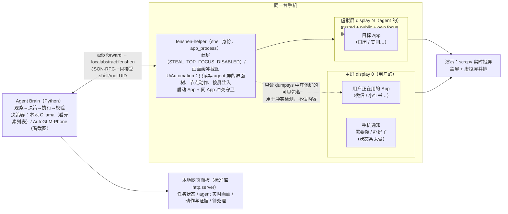

# 分身 Fenshen：和你同时用手机、但不碰你屏幕的 Agent

用户用一句话下达任务，agent 在**同一台手机**上一块用户看不见的虚拟屏里打开真实 App，一步步看界面、做决定、操作，直到任务真的完成。同一时间，用户照常用手机打字、刷信息流：前台 App、焦点、键盘都不受影响。需要用户的时候（发送、付款、登录），agent 停下来发一条普通通知；用户在电脑上的面板里允许这一步，或者自己打开那个 App 完成最后一步。

## 一页摘要

**难点和解法**：同机多屏方案的真正难点不在"开一块虚拟屏"，而在于全局只有一个焦点和一个输入法。实测证明，常见做法（scrcpy 虚拟屏 + 注入点击）每点一下都会抢走用户的焦点、收起键盘、吞掉用户正在打的字（E1）。本项目用一个 shell 身份的 helper 自己建屏，加上 `STEAL_TOP_FOCUS_DISABLED`，问题消失；对照组只差这一个 flag（E2）。agent 写字用 `ACTION_SET_TEXT`，不切输入法、不用剪贴板（E3）。不需要 Root。

**实测结果**（Android 17 / API 37 模拟器 + 真机 Solana Seeker / Android 16；原始数据见 [docs/experiments.md](docs/experiments.md)，每次运行的逐步记录在 `runs/`）

| | 结果 |
|---|---|
| 用户焦点 / 输入法被 agent 抢走 | E2 之后的全部运行（几十次），监视器样本数 **0** |
| 建闹钟（8 种说法：上午/下午、"半"、中文数字、中午 12 点……），AutoGLM-Phone | 最后一轮 **7/8**：开始执行的 7 个全部通过系统级校验，4–19 步，每步约 1.9 s；第 8 个是用户正好在用时钟时程序崩溃（已修） |
| 同样任务，本地 qwen2.5:7b | **0/13**（E5），模型看不懂界面状态；但它暴露的问题催生了后面一直在用的结构 |
| 存联系人 + 发短信（跨两个 App） | 完成；发送前守卫停下等用户允许；联系人库、短信库独立核实（E7） |
| 更多任务类型（E9，五轮） | 从 3/9 修到：闹钟 2/2、新建联系人 3/3、给联系人发短信 3/3、跨 App 2/2、给裸号码发短信 1/2；途中查出并修掉一个会"发错号码"的解析 bug（来自上游 Open-AutoGLM 的写法）和校验器过宽的问题 |
| 用户 App 的流畅度（E8，模拟器） | agent 空闲：与没有 agent 相同（janky 帧约 0.1–1%）；**agent 干活：janky 帧 15–22%**，需要优化 |
| 真机 + 第三方 App（E10、E11，Seeker） | 美团外卖点咖啡，用的是用户自己的账号和地址：16 步走到确认订单页并停下，没有付款；打扰监视 91 个样本全部为 0。第一次校验判错（真实的支付栏不在界面树里），已按真实页面改正，还没重跑 |
| "办好了"怎么判定 | 不信模型自己说的：查系统闹钟服务、联系人库、短信库，再对比任务前的基线 |

**关键设计**：决策器可替换（文本模型看元素列表 / 截图模型看图，D7），其余部分与模型无关：动作合法性检查、付款/登录/发送等敏感动作的确定性守卫、执行前重新观察、完成由系统状态判定、逐步留证（§4）。同一个 App 用户和 agent 抢着用时，agent 让路并等用户用完（§6、E4）。

**已知局限**（详见 §9 和各实验的"还没测"）

- 真机只测了一台（Solana Seeker，Android 16，接近原生 Android）；国内厂商 ROM、Android 13 及以下（没有那两个 flag）都没验证。
- 第三方 App 只测了美团外卖一条流程（E11）。闹钟、联系人、短信的批量测试是在模拟器上做的。
- **卡顿（E8）**：agent 空闲时用户 App 的流畅度不受影响；agent 干活时，模拟器上用户 App 的 janky 帧从约 1% 升到 15–22%（每秒约 60 帧降到约 50 帧），这一条目前在模拟器上不达标。已加 agent 屏限帧选项（`FENSHEN_VD_FPS`），效果未测，真机上应先测这一项。
- 手机端只有通知；agent 的实时画面在电脑上的网页面板里看，手机上的状态条没做。

**从哪里看起**：§1 问题拆解 → §3 关键决策（D2、D3 有 AOSP 源码依据）→ [experiments.md](docs/experiments.md) 的 E1/E2（问题与对照组）、E6（换模型后怎么一步步修）→ §13 AI 协作说明。

---

## 对照题目要求

| 要求 | 怎么做到的 | 证据 | 现状 |
|---|---|---|---|
| 是 agent，不是脚本 | 每一步看 agent 屏的截图决定下一步（AutoGLM-Phone）；App 经验只描述界面怎么用，不是点击序列 | 美团运行中自己关掉"神券到账"弹窗、等搜索结果加载；思考期间页面变了就重新观察（E11） | ✅ |
| 和用户同时用手机 | 同一台手机上的隐藏虚拟屏，作用于用户自己的 App 和登录态 | 真机 Seeker：用户一边用手机，agent 一边用用户自己的美团账号点单（E11） | ✅ |
| 真实第三方 App、多步 | 美团外卖：搜店 → 选规格 → 加购 → 结算，16 步 | E11 | ⚠️ 真机上只成功过 1 次（前 2 次失败的原因已修），稳定性要多跑几次才能下结论；一单约 2 分钟，模型推理约占一半 |
| 不切前台、不抢焦点和输入法 | 自研 helper 建屏时加 `STEAL_TOP_FOCUS_DISABLED`；写字走 `SET_TEXT`，不碰输入法和剪贴板 | E1（问题）、E2（对照组）；每次运行的监视器样本全部为 0 | ✅ |
| 没有明显卡顿 | 虚拟屏用小分辨率、按需截图、模型不在手机上跑 | E8：模拟器上 agent 干活时，用户 App 的 janky 帧升到 15–22% | ⚠️ 模拟器上不达标，真机没测 |
| 小状态提示；用户能发起、查看进度、随时接管 | 网页面板上发起任务、查看进度（含 agent 屏实时画面）；手机通知；用户打开同一个 App 就能接管 | E4、E7 | ⚠️ 进行中的状态提示没做；面板在电脑上（手机浏览器经 `adb reverse` 也能打开） |
| 主动交接 | 付款、登录、验证码只能交给用户（按控件文字、按模型自述的意图，两层守卫）；用普通通知请求介入 | E7（模拟器全流程）、E11（真机停在付款前） | ✅ 真机上"用户打开美团接手"还没验证 |
| 结果可验证、边界明确 | 完成由系统状态判定，不信模型：闹钟服务、联系人库、短信库；购物的边界"停在确认订单页、没付款"读界面树核实 | E6、E7、E9、E11 | ✅ 购物只能界面级核实（没有系统记录） |
| 设备权限 | 只用 ADB（shell 身份的 `app_process`），不需要 Root；真机只开了 USB 调试 | §8 | ✅ 普通用户的落地方式（无线调试自配对，Shizuku 思路）见 §8.2，未实现 |

---

## 1. 问题拆解：一人一屏的假设落在哪几层

手机系统从设计上就假设"一个人用一块屏"。要让两个"人"同时用一台手机，不是加一块屏就完事，而是要在下面每一层都把 agent 和用户隔开：

| 层 | 冲突 | 隔离手段 | 状态 |
|---|---|---|---|
| ① 显示 | 前台只有一个 App | 虚拟屏（VirtualDisplay）：App 跑在第二块屏上。Android 10 起多屏 multi-resume，两块屏上的 Activity 同时 RESUMED | ✅ |
| ② 焦点 | 每块屏有自己的焦点窗口，但**全局只有一块 top focused display**，按键事件和输入法跟着它走 | Android 14+：`OWN_FOCUS` **加** `STEAL_TOP_FOCUS_DISABLED`（只有 OWN_FOCUS 不够，见 E1）；更低版本：根本不产生会抢焦点的输入事件 | ✅ E1 问题存在 / ✅ E2 解法有效（API 37） |
| ③ 输入 | 往虚拟屏注入触摸，会把 top focus 拉过去 → 用户正在打的字丢失、键盘收起（E1 实测） | 屏幕加 `STEAL_TOP_FOCUS_DISABLED` 后，注入触摸不再抢焦点（E2）。低版本系统上用无障碍**节点动作**兜底，它不经过 InputDispatcher | ✅ API 37 / 🧪 低版本 |
| ④ 输入法 | 虚拟屏里的输入框获得焦点 → 系统默认把 IME 弹在**主屏** | 虚拟屏 IME policy 设为 `HIDE`/`LOCAL`；agent 写字走 `ACTION_SET_TEXT`，不切输入法、不用剪贴板 | ✅ API / 🧪 行为 |
| ⑤ App 实例 | 一个 Task 同一时刻只能在一块屏上。用户在用微信时 agent 也去启动微信 → 用户的微信被"拽"到虚拟屏 | 启动前检测冲突，协商而不是硬抢（见 §6） | 🧪 |
| ⑥ 共享资源 | 声音、振动、剪贴板、Toast、CPU/GPU | 任务期间对目标 App 静音/禁振；不碰剪贴板；虚拟屏降分辨率、按需截图 | 🧪 |

大多数实现只解决第 ① 层（开个虚拟屏 + `input tap`），demo 能跑，但用户一边打字一边让 agent 点，键盘大概率会出问题。**这个项目的重点在 ②–⑥ 层**，并且把"不打扰"做成可测量的指标，而不是一句声明（§7）。

---

## 2. 方案总览



**组件：**

1. **fenshen-helper（特权助手，[`helper/`](helper/src/com/fenshen/helper/)）**：以 shell 身份通过 `app_process` 运行（与 scrcpy-server 同一机制），是 agent 的"屏幕、眼睛和手"：
   - **建屏**：最初打算直接复用 scrcpy 的 `--new-display`，但 E1 证明 scrcpy 建的屏会抢焦点（缺 `STEAL_TOP_FOCUS_DISABLED`），所以建屏由 helper 负责（E2 已验证）。屏幕背后是 helper 自己持有的 `ImageReader`，截图直接从这块缓冲取。
   - **看和做**：通过 UiAutomation（和无障碍服务同一套 `AccessibilityNodeInfo` 接口）只读写 agent 屏：界面树、节点点击、`SET_TEXT`、按屏注入触摸和按键（E3 已验证）。
   - **启动 App 和冲突守卫**：用户屏上可见的 App 不会被启动到 agent 屏。
   - **按屏隔离**：所有接口都没有"选择屏幕"的参数，结构上就碰不到用户屏。
   - scrcpy 只用来投屏给人看（`scrcpy --display-id=N`）。
2. **Agent Brain（Python，开发期跑在 PC，[`brain/fenshen/`](brain/fenshen/)）**：任务理解、逐步决策、动作执行后的校验、完成判定、交接。设备层（`Device` 接口）和 LLM 接口都可替换。
3. **本地网页面板（[`web.py`](brain/fenshen/web.py)，只用 Python 标准库）**：显示任务状态、agent 屏的实时画面（每 250 ms 取一帧 helper 的画面缓冲）、每一步的截图、模型的理由和执行结果、校验证据、打扰监视结果；需要用户时显示"允许这一步 / 我处理好了 / 停止"。
4. **手机端的交接**：需要用户、办好了的时候发一条普通通知（E7）；用户打开同一个 App，agent 做到一半的页面就出现在用户屏上（E4）。进行中的状态提示（小 pill）还没做。

---

## 3. 关键技术决策（选了什么，为什么不选别的）

### D1 在哪里跑 App：同机虚拟屏，而不是第二台手机 / 云手机 / 锁屏后再做

| 方案 | 隔离难度 | 作用于用户自己的账号 | 结论 |
|---|---|---|---|
| 第二台手机 / 云手机 / 模拟器登录同账号 | 最简单 | 微信等单设备登录会互踢；验证码、风控都在用户手机上 | ✗ 回避了题目本身 |
| 等用户锁屏/放下手机再做 | 无 | 是 | ✗ 题目明确排除 |
| 纯 API / Intent / deeplink | 无 | 部分 | ✗ 不是操作界面；只当"跳转加速"的辅助动作 |
| **同机虚拟屏** | 难（②–⑥ 层） | **是：同一份 App、同一份登录态** | ✓ |

### D2 谁来创建虚拟屏：必须是 shell（或系统），普通 App 建的屏装不下第三方 App ✅

我一开始想全部做成普通 App（无障碍 + 自己建一块虚拟屏），对照源码后发现走不通。`ActivityTaskSupervisor.isCallerAllowedToLaunchOnDisplay()`（AOSP main 分支）：

```java
if (!display.isTrusted()) {
    // Limit launching on untrusted displays because their contents can be read from Surface
    // by apps that created them.
    if ((aInfo.flags & ActivityInfo.FLAG_ALLOW_EMBEDDED) == 0) {
        return false;   // 非 allowEmbedded 的 Activity 一律不能上非 trusted 屏
    }
    ...
}
```

普通 App 只能创建 untrusted 屏，而微信、美团这类 App 的 Activity 都不是 `allowEmbedded`，所以**无论谁发起启动都会被拒**。trusted 屏需要 `ADD_TRUSTED_DISPLAY`，shell 有这个权限。scrcpy 在 Android 13+ 正是以 shell 身份加上 `VIRTUAL_DISPLAY_FLAG_TRUSTED` 的（`NewDisplayCapture.java`）。

> 观察：WhalePhone 官网称只需要无障碍权限，就能在 private virtual display 里后台运行。按上面的 AOSP 规则，我在原生系统上复现不了这条路径。我推测它依赖适配机型（官网列出 ColorOS / HyperOS / Pixel）上的厂商能力，或者用了我还不知道的方法。这是答辩时想请教的问题；我的方案明确使用 shell 权限，并在 §8 说明普通用户如何获得它。

### D3 虚拟屏的 flags：public + trusted + own focus ✅

- **必须 `PUBLIC`**：`AccessibilityManagerService.isValidDisplay()` 会忽略 private 虚拟屏（SystemUI 自己的 bubble 除外），private 屏上的窗口对无障碍服务不可见。
- **`TRUSTED`**：见 D2。
- **`OWN_FOCUS`（Android 14+）**：`DisplayContent.hasOwnFocus()` = `mPerDisplayFocusEnabled || FLAG_OWN_FOCUS`。它让虚拟屏维护*自己的*焦点窗口和 touch mode。**但它不阻止虚拟屏成为 top focused display**：E1 实测中，scrcpy 建的屏已带 OWN_FOCUS，agent 一启动 App 或点一下，用户的键盘就被收起。
- **`STEAL_TOP_FOCUS_DISABLED`（Android 14+，`@SystemApi`）**：`DisplayContent.canStealTopFocus()` 读它，作用是禁止这块屏成为 top focused display，正是我们要的语义。✅ 源码：`VirtualDisplayAdapter` 只要求同时有 `TRUSTED` + `OWN_FOCUS`，`DisplayManagerService` 对它没有额外的权限检查，所以 shell 可以设置。scrcpy 没有设置它，这是自研 helper 补上的第一个能力。✅ **E2 实测**：加上这个 flag 后，agent 启动 App、点击、滑动都不再抢焦点，用户的键盘和按键都不受影响；对照组只去掉这个 flag，问题完全复现。
- **`DESTROY_CONTENT_ON_REMOVAL`**：虚拟屏关闭时销毁上面的 App，而**不是**把它们挪到主屏。否则 agent 一结束，它的 App 会突然出现在用户面前，这是很容易忽略的"打扰"。（scrcpy 默认就是销毁，`--no-vd-destroy-content` 反而是错的选择。）

### D4 输入法隔离：IME 不上主屏，agent 也不用 IME ✅ API / 🧪 行为

- `IWindowManager.setDisplayImePolicy(displayId, HIDE)`（scrcpy `--display-ime-policy=hide` 调的就是它）：虚拟屏里的输入框获得焦点时**不弹任何键盘**，更不会弹到主屏上。
- agent 写文字用 `AccessibilityNodeInfo.ACTION_SET_TEXT`：不经过输入法，中文、emoji 都能写。
- **明确不用**：
  - ADBKeyboard 这类"切换为自定义 IME"的方案：IME 是全局的，一切换用户的键盘就被换掉了。
  - 剪贴板粘贴：剪贴板也是用户的。
  - `input text`：只支持 ASCII，并且走输入事件。
- 退路：个别自绘输入框不支持 SET_TEXT 时，IME policy 改为 `LOCAL`（键盘只在虚拟屏里弹出），用按屏手势点虚拟屏上的键盘。

### D5 怎么"看"：无障碍树为主，截图兜底 ✅ E3

- Android 11+：`getWindowsOnAllDisplays()` 取虚拟屏的窗口树。截图不用 `screencap`（它只认物理屏），而是直接读 helper 为虚拟屏持有的 `ImageReader` 缓冲。
- **开发期用 shell 身份的 UiAutomation，而不是无障碍服务 APK**：接口相同，但不需要编译和安装 APK，用户也不用开无障碍权限，所有特权能力集中在一个 shell 进程里。连接时带 `FLAG_DONT_SUPPRESS_ACCESSIBILITY_SERVICES`，不挤掉用户自己的无障碍服务。代价是 UiAutomation 独占，helper 运行时 `uiautomator dump` 和 Appium 都连不上。面向普通用户时也可以换成无障碍服务（§8）。
- 实测（E3）：观察（快照 + 压缩）中位数 **4.3 ms**，截图 9 ms，`SET_TEXT` 16 ms；联系人页面 83 个节点压成 10 个元素，约 150 token。观察和执行层几乎不花时间，每一步的耗时基本都在模型推理。
- **树优先**的三个理由：
  1. 本地小模型大多是纯文本模型，树可以压缩成几十行带编号的元素列表，几百 token 就够；截图走视觉模型，又慢又贵。
  2. 树里有精确的 bounds、resource-id、clickable，节点动作不需要坐标推理。
  3. 隐私：agent 只看到自己那块屏，**看不到用户在主屏上做什么**。
- 截图只在三种情况下用：树信息不足（WebView、Flutter、Canvas 自绘控件）、完成校验时需要视觉证据、给人看的回放日志。
- FLAG_SECURE 页面（支付等）在非 secure 虚拟屏上截图是黑的，但无障碍树仍然可读。这类页面正好是天然的交接点。

### D6 怎么"做"：不产生输入事件的操作优先 ✅ E3（API 37）

按优先级降级：

1. **节点动作**：`ACTION_CLICK` / `ACTION_SET_TEXT` / `ACTION_SCROLL_FORWARD` / `ACTION_IME_ENTER`。在目标 App 进程内执行，不经过 InputDispatcher。E3 实测：节点点击和 `SET_TEXT` 都不影响用户的焦点和输入法绑定。
2. **按屏注入**：UiAutomation 注入触摸和按键事件，事件打上 agent 屏的 displayId。用于自绘控件、滑块、没有可点节点的场景。E2/E3 实测：屏幕加了 `STEAL_TOP_FOCUS_DISABLED` 后，注入点击输入框也不抢焦点、不弹键盘。🧪 Android 13 及以下需要另测。
3. ~~`input -d N`~~：每次都要另起一个进程，已被第 2 项取代。
4. **辅助动作**：`am start --display N`（必要时带 deeplink），直接跳到目标 App 或页面，减少步数。全局返回键用 `input -d N keyevent BACK`，**不用**无障碍的 `GLOBAL_ACTION_BACK`。✅ `SystemActionPerformer.sendKeyEventIdentityCleared()` 把这个按键注入到 `getLastNonProxyTopFocusedDisplayId()`，也就是用户的屏幕：agent 想在虚拟屏上返回，结果会让用户的 App 后退一页。

### D7 模型：决策器可插拔；结构兜底，模型负责看懂界面 ✅ 实测（E5、E6）

"怎么选下一步"是一个可替换的**决策器**（`Decider`），其余部分与模型无关：动作合法性检查、敏感动作守卫、执行前重新观察、完成由系统状态判定、逐步留证。目前有两种决策器：

| | `ElementDecider`（文本模型） | `AutoGLMDecider`（截图模型） |
|---|---|---|
| 模型 | 本地 Ollama `qwen2.5:7b`，或任意 OpenAI 兼容接口 | 智谱 `autoglm-phone`（手机 GUI 专用视觉模型，`ZHIPU_API_KEY`） |
| 看什么 | 压缩后的元素列表（编号 + 角色 + 文字 + 状态，约 150–500 token） | agent 屏截图（只有 agent 屏，用户屏从不截取、从不上传） |
| 输出 | JSON schema 约束的一个动作，目标只能是列表里的编号 | Open-AutoGLM 格式的 `do(action=…)`，坐标为 0–999 归一化 |
| 文字输入 | `fill` → `ACTION_SET_TEXT` | `Type` → 对**已聚焦**输入框 `ACTION_SET_TEXT`（不切输入法） |
| 建闹钟实测 | **0/13**（E5） | 最后一轮 **7/8**（开始执行的 7/7，E6） |
| 每步耗时 | 2.2–2.7 s（RTX 3070，与模拟器共用显存） | 约 1.5–3 s（云端） |

- **为什么先用本地 7B**：没有付费 API；本机 8 GB 显存放不下 30B 级模型（Q4 约 17–27 GB，大量 CPU offload，一步几十秒），而 Ollama 0.5.7 跑不了 qwen3 / gemma4。7B 的问题不是速度，而是看不懂界面状态：AM/PM 判断错、读不准单选框、认不出任务已完成（E5）。
- **为什么接 AutoGLM-Phone**：它是为手机 GUI 训练的模型，智谱开放平台可直接调用。接入时只换决策器：截图来自 helper 的画面缓冲，点击和滑动注入到 agent 屏（E2/E3 已证明不抢焦点），`Type` 走 `SET_TEXT`。Open-AutoGLM 原本操作的是**前台主屏**，并且通过切换系统输入法（ADB Keyboard）打字。这两点正是本题要避免的，所以只沿用它的提示词和解析格式，执行层用我们自己的。
- **训练分布要对齐**（E6 的关键发现）：AutoGLM 被教会了"看到底部的 `ADB Keyboard {ON}` 才说明可以输入"。agent 屏的 IME 策略是 HIDE，从来不弹键盘，模型就以为输入框没激活，反复点击和滑动。现在当界面树报告有聚焦的输入框时，就在发给模型的截图上画出同样的提示条（只改发给模型的图，不改屏幕）。改完之后，同一个任务从卡死变成 12 步完成；再加上动作效果反馈、App 经验和任务参数换算，最后一轮 8 个不同说法的任务 7 个完成（E6）。
- **用结构而不是模型大小解决问题**（两种决策器共用）：
  - 完成由环境判定：每步之后查系统状态，达成即停；出现错误结果立即停，不让模型接着"修"（E5）。
  - 能确定性判断的错误直接拒绝并说明原因：点纯文字、点已选中的单选项、坐标越界。
  - 把动作的实际效果说清楚，不让模型自己比对两张图：例如"上一步的结果：「Hour」现在是 \"15\""，或者"滑动起点是输入框，那里没有可以滚动的东西"。
  - App 经验（[`skills.py`](brain/fenshen/skills.py)）：每个 App 一段简短提示，描述界面怎么用，而不是点击脚本；文本模型和截图模型各有一份措辞。**不写具体数字**：7B 会照抄示例里的时间（E5）。
- 没有做的：规划与执行分离（先列子目标）。闹钟任务步数少，没有必要；外卖这类长任务再加。

### D8 开发形态：PC 大脑 + ADB；目标形态：全部在手机上

- 开发期 Brain 跑在 PC：迭代快、日志方便，LLM 也在 PC 上。
- 开发期的界面是一个本地网页面板（标准库 `http.server`，不引入依赖），显示任务状态、agent 屏的实时画面、最近的动作和证据、等待用户处理的事项。手机端状态条在后期补上。
- 面向普通用户的形态见 §8。

### D10 路线：同机虚拟屏为主线，双设备作为保底后端

我也认真考虑过另一条常见路线：两个 AVD，一个当用户手机、一个给 agent 用，用 Appium 操作，再靠同一账号的多端同步让用户看到结果。最终把它作为**保底**，而不是主线：

| | 同机虚拟屏（主线） | 双设备 + 账号同步（保底） |
|---|---|---|
| "不打扰"是否需要解决 | 需要，这正是本题的难点；E1/E2 已经实测解决（API 37） | 天然成立，没有可展示的东西 |
| 作用于用户自己的 App 和账号 | 是：同一份 App、同一份登录态 | 只适用于支持多端同步的 App；微信这类单设备登录的 App 会互踢 |
| 现实中的形态 | 用户自己的手机 | 用户没有第二台手机，最终会变成云手机，需要把账号登录到云端 |
| 工程风险 | 高（系统版本差异、厂商 ROM） | 低 |

- **实现方式**：Brain 只依赖一个 `Device` 接口（观察、执行动作、截图、启动 App）。主线实现是 `VirtualDisplayDevice`（同机，固定 displayId）；保底实现是 `SeparateDevice`（另一台设备，固定 serial）。
- **切换条件**：如果同机方案在某个必须的环节被证伪，就切到保底，agent 循环、模型接口和网页面板都不用改。
- **不选 Appium 做主线后端的原因**：按我的了解，UiAutomator2 的点击是注入触摸，和 E1 中会抢焦点的 `input -d` 走同一条系统通路（尚未在 Appium 上实测）。不过加了 E2 的 flag 之后这个问题已经消失，所以如果它在观察和元素定位上更省事，仍然可以接进来。保底后端可以用它。

### D9 设备：先用模拟器，最终 demo 尽量上真机

（10 月 29 日起已在真机 Solana Seeker / Android 16 上运行，见 E10、E11。）开发期没有真机，先用 Android Studio 模拟器（实际用的是 API 37 / Android 17 的 Google Play 镜像，x86_64 + ARM 转译；之后再加一个 API 33 镜像做没有 OWN_FOCUS 的对照）：有 OWN_FOCUS、能装大部分 App，也便于反复复现。已知局限：部分 App（淘宝、银行类）会检测模拟器；厂商 ROM（HyperOS、ColorOS）对多屏的魔改测不到。这些限制会如实写进实测记录。

---

## 4. Agent 循环

实现在 [`agent.py`](brain/fenshen/agent.py)，每一步：

```
观察 ── agent 屏界面树（压缩）+ 截图（只取 agent 屏）
决策 ── 决策器给出一个动作（文本模型：元素编号；截图模型：坐标）           ← 唯一和模型有关的一步
检查 ── 动作在当前屏幕上是否合法？不合法：不执行，把原因告诉模型；连续 3 次就停
守卫 ── 付款/下单/登录/密码/验证码 → 只能交给用户；删除/同意 → 用户允许这一步后才执行
防循环 ─ 同一界面上同一动作第 3 次 → 停下求助
重新观察 模型思考期间页面变了、目标已不在原处 → 不执行，用新屏幕重来
执行 ── 节点动作 > 注入到 agent 屏的手势；全局返回键也注入到 agent 屏（D6）
等待 ── 无障碍事件静默 + 2 s 宽限（弹窗常常晚一点才出现）
判定 ── 查系统状态：目标已达成 → 校验后结束；出现了任务以外的结果 → 立即停
反馈 ── 把动作的实际效果写给模型：写进了哪个框、开关现在的状态、滑动处是否可滚动、App 是否被系统回收
留证 ── steps.jsonl：界面、截图、模型原文、动作、执行方式、变化、校验结论、token、耗时
```

- **动作空间**：`launch`、`tap`、`fill`、`submit`（无键盘回车）、`scroll`、`swipe`、`long_press`、`double_tap`、`back`、`home`、`wait`、`ask_user`、`done`。截图模型的 `Take_over` / `Interact` 映射为 `ask_user`，带 `message=` 的 `Tap`（模型自己标记的敏感操作）映射为"需用户允许"。
- **完成不由模型说了算**：每步之后，校验器先查系统状态（闹钟任务：`dumpsys alarm` 的下一个闹钟），达成就停；模型说 `done` 时，再读一遍闹钟清单对比基线，要求"恰好新增一个目标闹钟、没有其他变化"。校验不通过就结束任务交给用户，不让模型"继续修"（E5：小模型会再建一个）。
- **认不出的页面就停下**：文本模型遇到没有可读控件的页面（WebView、游戏）直接暂停说明；模型自己 `ask_user` 也会暂停。不猜着继续。
- **只操作 agent 的屏**：helper 的 RPC 里根本没有"选择屏幕"的参数（E3），注入事件一律打上 agent 屏的 displayId，`am start` 的 `--display` 由 helper 决定。
- **App 被系统回收**：agent 屏上的 App 优先级是 visible，低于用户的前台 App，内存紧张时会先被杀（E6 实测，用户屏上开着美团时）。这个顺序对用户是对的；循环检测到"App 消失且进程已不在"，就告诉模型重新打开。
- **敏感动作守卫（确定性，不依赖 LLM）**：按目标元素的文字判断。付款、下单、登录、密码、验证码只能由用户本人完成；删除、同意协议、发送消息、给 App 授权这类撤不回的操作，在面板上请用户"允许这一步"，允许后只执行那一步，拒绝后告诉模型不许换个方法绕过。

---

## 5. 交接：主动求助不算打扰

- **触发**：敏感动作守卫、登录页、验证码、FLAG_SECURE 页面、模型连续失败、校验不通过、需要的 App 正在用户屏上。
- **手机上的通知** ✅（[`notify.py`](brain/fenshen/notify.py)，E7）：需要用户、办好了、在后台等用户用完某个 App 时，发**一条普通通知**（同一条原地更新）。**不弹全屏、不切前台**，用户决定什么时候处理。
- **两种处理方式** ✅（E7）：
  1. 在网页面板上点"允许：点「Send SMS」"（只对删除、同意、授权、发送这类出现），agent 只执行这一步；或者"不允许"，agent 不会换个方法绕过。
  2. 用户自己打开那个 App（例如「短信」）。按 E4 的系统行为，agent 做到一半的 Task（写好的草稿）会整个出现在用户屏上，用户自己点最后一步；面板在后台查系统状态，发现短信真的发出去了，就判定完成并发"办好了"通知，不需要再点"继续"。
- **付款、登录、验证码**：只有第 2 种，agent 永远不点。
- **通知上没有点击动作**：shell 发的通知挂不上 Intent（E7：API 37 拒绝），所以通知里写的是"打开「短信」"。手机端有自己的 App 时，把"打开这个 App"直接挂在通知上即可，机制不变。
- **完成边界写清楚**：购物任务的边界是"停在确认订单页，页面上是任务要的商品，没有点支付，也没有进入收银台或支付成功页"，由校验器读界面树核实（E11）。规格和价格写进证据给人看，不做比对：任务里没有指定。

---

## 6. 同一个 App 的冲突（⑤ 层）

这是同机方案特有、也最容易翻车的地方：

- **agent 要用 App P，用户此刻正在用 P**：不启动，不抢。✅ 已在 helper 里实现：每次启动前，从 `dumpsys activity activities` 中取出其他屏上 `visible=true` 的 Task 所属的包名，命中就拒绝（E3 实测）。✅ agent 在后台每 2 秒看一次，用户离开 P 就自动继续（最多等 10 分钟）；完成校验需要先读基线时也一样等。
- **agent 正在虚拟屏里用 P，用户从桌面点开了 P**：✅ E4 实测，结果和我原先猜的相反：系统不是在虚拟屏上拉起，而是把 agent 的 Task **整个搬到用户屏**（`wm_task_moved … 0`），用户会看到 agent 做到一半的界面。现在的处理：agent 下一步想用 P 时被冲突守卫挡住，识别出"P 是本次任务用过的"，就告诉用户"系统把分身做到一半的界面移到了你的屏幕上，你可以接着完成；或者按 Home 退出，分身会自动接着做"，然后等用户离开。🧪 更好的做法是从根上避免被搬走（见下一条）。
- **能多开的 App**（少数支持多窗口多实例的 App）：🧪 尝试 `FLAG_ACTIVITY_MULTIPLE_TASK`，各开一个实例，互不影响。
- **demo 的选择**：用户用聊天 App，agent 用日历或购物 App，避开冲突；冲突处理单独录一段演示。

---

## 7. "不打扰"和"办好了"都要可测量

**打扰监视器**（[`runner.py`](brain/fenshen/runner.py) 的 `DisturbanceMonitor`）在整个任务期间每秒采样一次，只读 dumpsys，结果写进 `runs/` 并显示在面板上：

| 指标 | 采集方式 | 通过标准 | 现状 |
|---|---|---|---|
| top focus 不被抢 | `dumpsys window` 中 `mTopFocusedDisplayId` | 全程为 display 0 | ✅ 每次运行都监视；E2 以后全部为 0（含真机 E10、E11） |
| 键盘不被抢 | `dumpsys input_method` 中的焦点客户端和 IME 窗口所在屏；开始时键盘开着、用户没离开当前页面却被收起，也算一次 | 始终绑定用户的输入框 | ✅ 同上 |
| 主屏前台 App 不变 | display 0 的 resumed activity | 全程为用户的 App | ✅ 记录在每个样本里，用于判断键盘收起是不是用户自己离开造成的 |
| 用户 App 不卡 | `dumpsys gfxinfo <用户App>` 的 janky frames 比例（[`tools/jank_probe.py`](tools/jank_probe.py)，单独跑） | 与 agent 未运行时相比无显著上升 | ⚠️ 模拟器上 agent 干活时不达标（E8）；真机没测 |
| 声音 / 振动 | 任务期间对目标包 `appops set <pkg> PLAY_AUDIO ignore` / `VIBRATE ignore` | 无外放 | 🧪 没做 |
| 剪贴板 | — | 不变 | 设计上不用剪贴板（D4），没有专门检测 |

**降低开销**：虚拟屏 720×1280 / 低 dpi；截图按需而不是持续编码；LLM 不跑在手机上。

**完成校验**：尽量用 UI 之外的独立途径核实：

- 日历 / 待办：通过 `CalendarContract` ContentProvider 查询该事件是否存在、时间和提醒是否正确（shell 没有权限时由 APK 申请 `READ_CALENDAR`），再回到 App 列表页做 UI 层确认。
- 购物（E11）：读确认订单页的界面树，按页面结构认出确认页（订单明细、配送信息、备注栏，且没有店铺页的按钮），核对商品名，并确认没有进入收银台或支付成功页。美团的支付栏不在界面树里，所以不能靠"找到提交订单按钮"来判断。

---

## 8. 在真机上运行

### 8.1 现在就能做：电脑 + 一根数据线（或无线调试）

现在的形态是：Brain 跑在电脑上，通过 adb 控制手机；helper 由 Brain 在启动时自动推到手机的 `/data/local/tmp` 并以 shell 身份运行。手机上不需要装任何 App，也不需要 Root。

1. **手机要求**：Android 14 及以上。不打扰的关键 flag（`OWN_FOCUS`、`STEAL_TOP_FOCUS_DISABLED`）是 Android 14 才有的；更低版本能跑，但会出现 E1 的抢焦点问题。
2. **打开开发者选项和 USB 调试**：设置 → 关于手机 → 连点"版本号"7 次 → 开发者选项 → 打开"USB 调试"。部分厂商还要多开一个开关，否则 adb 注入点击和 `UiAutomation` 会被拒：
   - 小米 / HyperOS：再开"USB 调试（安全设置）"（需要插 SIM 卡、登录小米账号）；
   - OPPO / 一加 / ColorOS：开"禁止权限监控"；
   - vivo / OriginOS：开"USB 模拟点击"一类的选项（名称因版本而异）。
3. **连接**：数据线连电脑，手机上点"允许 USB 调试"，然后 `adb devices` 能看到序列号。不想插线可以用无线调试（Android 11+）：开发者选项 → 无线调试 → 使用配对码配对，在电脑上 `adb pair <IP:端口> <配对码>`，再 `adb connect <IP:端口>`。
4. **运行**：和模拟器完全一样，多台设备时用 `--serial` 指定：
   ```bash
   fenshen web --llm autoglm --serial <adb devices 里的序列号>
   ```
   第一次运行会推送 helper 并在手机上建一块看不见的虚拟屏；网页面板左侧就是那块屏的实时画面。手机上的通知（"分身需要你确认"等）照常出现。
5. **第三方 App**：在手机上用你自己的账号登录好（美团、微信等），然后**回到桌面**再下任务。agent 不会去抢你正在用的 App（§6）。付款、登录、验证码一律停下交给你。

**真机上已知需要验证或调整的地方**（都没在真机上测过）：

- 厂商 ROM 对 `app_process` 常驻进程、`UiAutomation` 连接和虚拟屏启动第三方 App 的限制各不相同，需要逐个机型试；
- 闹钟的完整校验（对比闹钟清单）只认识 Google 时钟。厂商自带时钟时会自动退回到只核对系统的下一个闹钟，结果里会注明；
- App 经验（skills）目前只写了 Google 时钟、联系人、短信，并且只在手机上装了对应 App 时才发给模型；
- 联系人、短信的校验读的是系统 ContentProvider。部分 ROM 可能不让 shell 读短信库，读不到时校验会失败而不是误报成功。

### 8.2 目标形态：不需要电脑（未实现）

只有"建 trusted 虚拟屏 / 把 App 启动到虚拟屏 / 迁移 Task"需要 shell 权限，其余都是普通 App 权限（无障碍、悬浮窗、通知）。

- **Android 11+ 无线调试**：用户在开发者选项里开启无线调试，和本 App 配对一次（Shizuku 同款思路）。App 在手机上自己连接本机 adbd，用 `app_process` 拉起 fenshen-helper，之后全程不需要电脑。
  - 代价：重启后需要重新打开一次无线调试（不需要重新配对）。部分 ROM 还需要额外开关，例如 HyperOS 的"USB 调试（安全设置）"。
- **Brain 上手机**：Python Brain 换成 APK 内的 Kotlin 实现；LLM 走云端 API，或者使用端侧小模型。
- **不做**：Root、系统签名、改 ROM。如果和厂商合作拿到系统权限，helper 可以直接并入系统服务，但这不是普通用户的路径。

---

## 9. 风险与待实测清单（D1 的第一件事）

| # | 假设 | 依据 | 验证方法 | 不成立时的备选 |
|---|---|---|---|---|
| 1 | shell 建的 trusted public 虚拟屏能启动第三方 App | scrcpy `--new-display` | `am start --display N` 启动目标 App | ✅ E1：能启动，主屏前台不变 |
| 2 | 无障碍接口能看到并操作该屏 | AMS `isValidDisplay` | `getWindowsOnAllDisplays` + 节点动作 | ✅ E3：shell 身份的 UiAutomation 可读可写 |
| 3 | 节点动作不改变 top focus，用户打字不受影响 | 节点动作不经过 InputDispatcher | 用户持续打字 + 监视器 | ✅ E3；之后所有 agent 运行（E5、E6）全程监视，焦点和输入法被抢的样本数都是 0 |
| 4 | 只有 OWN_FOCUS 时，启动、手势、注入都会抢焦点 | DisplayContent 源码 | 实测 | ✅ E1：**确认会抢**（API 37，OWN_FOCUS 已生效），键盘被收起，按键丢失。🧪 API ≤33 没有这两个 flag，待测 |
| 5 | IME policy HIDE + SET_TEXT 能写中文且不弹键盘 | `setDisplayImePolicy` | 在虚拟屏输入框写中文 | ✅ E3：中文写入成功，任何屏都不弹键盘，输入法绑定始终在用户 App 上 |
| 6 | shell 能设置 `STEAL_TOP_FOCUS_DISABLED`，并且它能阻止 E1 的焦点抢夺 | ✅ 源码：只要求 TRUSTED + OWN_FOCUS，无额外权限 | 自研 helper 建屏，重复 E1 | ✅ E2：**有效**，有对照组 |
| 7 | 目标 App 在虚拟屏上正常运行 | — | 逐个 App 试 | ✅ 时钟、联系人、设置。美团（arm64 包，在 x86_64 模拟器上靠 ARM 转译运行）：模拟器上登录要求人脸识别，外卖小程序页在**用户屏**上也反复 native 崩溃，所以没能在虚拟屏上测。✅ 真机（E11）：美团外卖在隐藏屏上正常运行，搜索、选规格、加购、结算都能走通 |
| 8 | 用户点开 agent 正在用的 App 时的系统行为 | — | 复现 §6 场景 | ✅ E4：系统把 agent 的 Task 整个搬到用户屏 → 按交接处理，用户离开后自动继续 |
| 9 | 虚拟屏上 App 的 Toast、声音出现在哪里 | — | 复现 | appops 静音 |
| 10 | Task 能在屏间迁移（交接） | — | 迁移后状态是否保留 | ✅ E4：用户打开同一个 App 时系统会迁移，界面状态保留；E7 把它用作交接方式 |

---

## 10. 演示计划

- **用户侧（主屏）**：在设置搜索或聊天 App 里一直打字，中间切出去再切回来。
- **agent 侧（虚拟屏）**：
  - A（已跑通，用于视频）："帮我定一个晚上 9 点半的闹钟"，模型用 AutoGLM-Phone，完成后由系统闹钟服务独立核实。原计划的日历日程需要 Google 账号，模拟器上没有登录，所以换成时钟。
  - B（已跑通，E7）："把王小明（13800001234）存进联系人，然后给他发短信：明天下午三点开会，别迟到"：跨两个 App；发送前停下，手机上出现"分身需要你确认"的通知；用户在面板点允许，或者自己打开「短信」点发送；完成由联系人库和短信库独立核实。不需要任何登录。
  - C（真机，E11）："帮我在美团点一杯瑞幸的生椰拿铁，停在提交订单前"。走到确认订单页后停下，用通知叫用户；用户打开美团，就能看到 agent 做好的确认页（E4 的迁移），付不付款由用户决定。
- **画面布局**：左边模拟器主屏（用户在打字），右边 agent 屏的实时画面（scrcpy 只读投屏或网页面板），面板上同时显示每一步、校验结论和打扰监视结果。
- 冲突处理（§6，E4）单独录一段：agent 做到一半时，用户点开时钟。

**录制步骤**（Windows 自带的截图工具就能录屏：`Win + Shift + R`，框选区域）：

1. 模拟器开着，停在桌面。终端里：`cd brain`，然后 `python -m fenshen web --llm autoglm`，浏览器打开 http://127.0.0.1:8765 。
2. 把模拟器窗口放左边、面板放右边，框选这两个窗口开始录制。
3. 在模拟器上打开"设置"，点顶部搜索框，开始慢慢打字（键盘弹出）。
4. 在面板里输入任务"帮我定一个晚上9点半的闹钟"，点运行。右边会实时显示 agent 屏的画面和每一步；左边继续打字、切换 App。
5. 结束时面板显示"系统检测到目标已达成"、校验证据和打扰监视结果（焦点 / 输入法被抢的样本数为 0）。之后可以在模拟器上打开时钟，给观众看新建的闹钟。**任务结束后再打开时钟**；任务进行中打开，就会触发 E4 的交接（那正好是第二段要录的内容）。
6. 第二段（任务 B）：面板里输入"把王小明（13800001234）存进联系人，然后给他发短信：明天下午三点开会，别迟到"。agent 停在发送前时，模拟器顶部会出现"分身需要你确认"的通知，下拉通知栏给观众看；然后在模拟器上打开「短信」，agent 写好的对话会出现在你屏上，你自己点发送，面板随即显示"你在自己的屏幕上完成了最后一步，系统确认……"。（也可以直接在面板点"允许"。）

**真机录制**：所有画面都在电脑上录，一次录完，两块屏自然同步。

1. 手机连电脑，回到桌面。**双击仓库根目录的 [`demo.cmd`](demo.cmd)**，它等于 `fenshen web --llm autoglm --demo`。第一次使用前先 `setx` 设好 `ANDROID_SDK_ROOT`、`FENSHEN_SCRCPY`（scrcpy.exe 的路径）、`ZHIPU_API_KEY`；同时连着模拟器时再设 `FENSHEN_SERIAL`。缺哪个，`demo.cmd` 会直接告诉你。结束时在它的命令行窗口按 Ctrl+C，三个窗口会一起关掉。
2. 三栏按主屏幕的可用区域自动计算；每个窗口出现时会被摆到固定位置（投屏重开也一样），之后可以手动挪动：
   - 左：手机自己屏幕的实时投屏，只看不控，你在真机上的每个操作都同步显示；
   - 中：agent 屏的实时投屏，每个新任务换新屏时窗口会跟着换；
   - 右：浏览器自动打开精简面板（`/?demo`），按 `Win + →` 贴到右半边。面板上有任务、实时的打扰监视计数（焦点被抢 / 输入法被抢）、每一步：最新一步显示模型完整的思考，较早的步骤只显示它做出的决定。
3. 想让观众看到手指的点按：在手机上打开 开发者选项 → "显示点按操作反馈"。只看不控的投屏不能替你打开这个开关（scrcpy 的限制）。用 `Win + Shift + R` 录全屏，要加字幕就用 OBS。
4. 观众最容易看不懂的是"中间那块屏在哪"，开头要用一行字幕交代：两块屏都属于同一台手机；中间那块在手机里，但手机上看不到，只是投到电脑上给观众看。可以再用另一台手机实拍几秒，证明左边是真手机在被人用。

---

## 11. 目录结构

```
agent/
├── README.md
├── pyproject.toml                # pip install -e .，命令行入口 fenshen
├── tests/                        # 离线单元测试（解析、守卫、循环、AutoGLM 适配、校验器），不需要设备
├── docs/
│   ├── experiments.md            # E1–E6 实测记录（含失败、对照组和成功率）
│   └── img/                      # 实验截图证据
├── helper/                       # fenshen-helper：app_process 特权进程（Java，无需 Gradle）
│   ├── build.sh                  # javac + d8 → build/fenshen-helper.jar，可选 adb push
│   └── src/com/fenshen/helper/
│       ├── Main.java             # 入口：vd（只建屏）/ serve（建屏 + UiAutomation + RPC）
│       ├── AgentDisplay.java     # 虚拟屏 flags、IME policy、ImageReader 截图
│       ├── Automation.java       # UiAutomation：只读写 agent 屏（快照、节点动作、按屏注入、idle）
│       ├── Commands.java         # RPC 命令、启动 App、同 App 冲突守卫
│       ├── RpcServer.java        # localabstract 上的 JSON-RPC，UID 校验
│       └── ShellEnv.java         # 冒充 shell 的 Context、IWindowManager、exec
├── brain/fenshen/                # Python（Brain 只用标准库；Pillow 可选，给截图模型画输入提示）
│   ├── __main__.py               # python -m fenshen run "任务" / web
│   ├── adb.py                    # 固定 serial 的 adb 封装
│   ├── helper_client.py          # RPC 客户端
│   ├── device.py                 # Device 接口 + VirtualDisplayDevice
│   ├── observation.py            # 界面树 → 带编号的元素列表
│   ├── agent.py                  # agent 循环、ElementDecider（文本模型）、守卫、允许/交接
│   ├── autoglm.py                # AutoGLMDecider：截图模型适配（提示词/解析沿用 Open-AutoGLM，执行层自己的）
│   ├── llm.py                    # Ollama / OpenAI 兼容接口
│   ├── skills.py                 # App 经验（文本版 + 截图版 + 任务参数换算）
│   ├── verify.py                 # 独立完成校验（系统闹钟 + 闹钟清单对比）
│   ├── runner.py                 # 组装设备/模型/循环；打扰监视器；scrcpy 只读投屏
│   ├── web.py, static/index.html # 本地网页面板
│   ├── notify.py                 # 手机上的普通通知（需要你 / 办好了 / 在等你）
│   └── disturbance.py            # 焦点/输入法采样（打扰监视）
├── tools/
│   ├── focus_probe.sh            # E1/E2 探针
│   ├── e3_probe.py               # E3 探针
│   ├── reset_alarms.py           # 测试机清理：把所有闹钟关掉（不删除），也在 agent 屏上做
│   ├── bench_tasks.py            # 通过网页面板连续跑多个任务并汇总
│   └── summarize_runs.py         # 把一段时间内的 runs/ 汇总成表（E6 的基准数字来自它）
└── runs/                         # 每次运行的原始记录（不入库）
```

还没做：双设备保底后端（`SeparateDevice`）。同机方案的每个必要环节都已验证可行，暂时用不到它。

### 快速开始

需要：Python 3.10+；Android SDK（adb；编译 helper 还要 `platforms/android-37` 和 `build-tools`）；JDK 11+（Android Studio 自带的 `jbr` 即可）；一台开了 USB 调试或无线调试的 Android 14+ 设备（开发用的是 API 37 模拟器）。可选：scrcpy（终端运行时弹出 agent 屏的只读投屏）。

```bash
# 环境变量（Windows 用"编辑系统环境变量"设成用户变量）：
#   ANDROID_SDK_ROOT=<SDK 目录>      JAVA_HOME=<JDK 目录>      FENSHEN_SCRCPY=<scrcpy 可执行文件>（可选）
#   ZHIPU_API_KEY=<智谱开放平台的 key>   只用 AutoGLM 时需要；只放在环境变量里，不要写进任何文件
bash helper/build.sh                    # 产出 helper/build/fenshen-helper.jar，运行时自动推到设备
pip install -e ".[vision]"              # 只装本项目；vision 是可选的 Pillow（给截图模型画输入提示）
python -m unittest discover -s tests -t .   # 离线单元测试，不需要设备

fenshen run "帮我定一个晚上9点半的闹钟" --llm autoglm    # 终端运行
fenshen web --llm autoglm                                  # 网页面板 http://127.0.0.1:8765
# 本地模型：ollama pull qwen2.5:7b，然后 --llm ollama:qwen2.5:7b（默认）；任意 OpenAI 兼容接口：--llm openai:<model>
```

设备有多台时用 `--serial` 或 `FENSHEN_SERIAL` 指定。不装包也可以：`cd brain && python -m fenshen ...`。

每次运行的完整记录在 `runs/<时间>-<任务>/`：`steps.jsonl`（每一步的界面、模型原文、动作、结果、校验）、`step-NN.jpg`（agent 屏截图）、`step-NN-model.jpg`（发给截图模型的那张图）、`monitor.jsonl` 和 `disturbance.json`（打扰监视）、`baseline.txt`、`outcome.json`。

## 12. 路线图（截止约 11 月 1–3 日）

| 天 | 内容 |
|---|---|
| D1 ✅ | 环境（Android Studio、API 37 模拟器、scrcpy）；E1（问题复现）；自研 helper；E2（解法 + 对照组） |
| D2 ✅ | 观察与执行层：helper 增加 UiAutomation + JSON-RPC（UID 校验、按屏隔离、冲突守卫、画面缓冲截图）；`VirtualDisplayDevice` + 观察压缩；E3（中文输入不扰民） |
| D3 ✅ | agent 循环（检查、守卫、允许/交接、环境判定完成、逐步留证）；本地 7B 实测（E5，0/13）；网页面板；打扰监视器；§6 冲突自动等待；E4 |
| D4 ✅ | 接入 AutoGLM-Phone（E6）：输入提示对齐、动作效果反馈、App 经验截图版、App 被回收的恢复；校验器修正；成功率基准 |
| D5 | 录 demo 视频（用户打字 + agent 屏实时画面 + 校验结果）；真机的话做美团任务 B |
| D6 | 补全 README 和答辩材料；有余力：从根上避免 E4 的 Task 搬移、Android 13 对照 |

## 13. AI 协作说明（持续补充）

- **用 AI 做调研时，以源码为准而不是以记忆为准**：关于虚拟屏 flags、启动权限、无障碍屏幕过滤的结论，都让 coding agent 拉取 AOSP main 分支和 scrcpy 源码的对应函数后再写进来（D2、D3 引用的代码片段）。D2 的结论正是这样得到的：它推翻了最初"全部做成普通 App"的设想。
- **模型选型基于实测**：D7 的数字和那个错误决策例子都来自本机实际调用。
- **调试 agent 时先读证据，再提假设**：每次失败都从 `runs/` 里的逐步记录入手：截图、界面树、模型原文的 `<think>`。例如 AutoGLM 卡在时间选择框（E6），界面树显示小时框已经 `focused` 且可编辑，说明执行层没问题；模型原文里它一直在找键盘；再对照 Open-AutoGLM 的提示词，才定位到"训练时靠 ADB Keyboard 提示条判断能否输入"。修复只改发给模型的那张图，没有改模型的动作。
- **用基准而不是单次成功下结论**：一次跑通之后，再连续跑多个不同说法的任务（上午/下午、"半"、中文数字、中午 12 点），按失败模式逐个处理。基准也查出了我自己的 bug：闹钟清单扫描只往下翻，把没动过的闹钟判成"消失"。所以校验器本身也要被校验：事后用修好的扫描读最终清单，重新核对了上一轮的结论。
- **安全边界写在代码里，不交给模型或提示词**：付款、登录、删除的守卫是正则 + 界面树判断；"完成"由系统状态判定；API Key 只从环境变量读，代码和记录里都不出现。
- **AI 写代码的审查方式**：coding agent 写完每块之后，在真机或模拟器上跑，用打扰监视器和 `logcat -b events` 核对系统层面实际发生了什么（例如 E4 的 `wm_task_moved`、E6 里低内存回收的 `am_proc_died`），不只看"脚本没报错"。

## 参考

- AOSP `ActivityTaskSupervisor.isCallerAllowedToLaunchOnDisplay`：[frameworks/base/services/core/java/com/android/server/wm/ActivityTaskSupervisor.java](https://android.googlesource.com/platform/frameworks/base/+/refs/heads/main/services/core/java/com/android/server/wm/ActivityTaskSupervisor.java)
- AOSP `AccessibilityManagerService.isValidDisplay`：[frameworks/base/services/accessibility/…/AccessibilityManagerService.java](https://android.googlesource.com/platform/frameworks/base/+/refs/heads/main/services/accessibility/java/com/android/server/accessibility/AccessibilityManagerService.java)
- AOSP `DisplayContent.hasOwnFocus / canStealTopFocus`：[frameworks/base/services/core/java/com/android/server/wm/DisplayContent.java](https://android.googlesource.com/platform/frameworks/base/+/refs/heads/main/services/core/java/com/android/server/wm/DisplayContent.java)
- AOSP `DisplayManager` 虚拟屏 flags：[frameworks/base/core/java/android/hardware/display/DisplayManager.java](https://android.googlesource.com/platform/frameworks/base/+/refs/heads/main/core/java/android/hardware/display/DisplayManager.java)
- AOSP `SystemActionPerformer`（无障碍全局动作的按键注入目标屏）：[frameworks/base/services/accessibility/…/SystemActionPerformer.java](https://android.googlesource.com/platform/frameworks/base/+/refs/heads/main/services/accessibility/java/com/android/server/accessibility/SystemActionPerformer.java)
- scrcpy `NewDisplayCapture.java`：[Genymobile/scrcpy](https://github.com/Genymobile/scrcpy/blob/master/server/src/main/java/com/genymobile/scrcpy/video/NewDisplayCapture.java)
- WhalePhone：<https://phone.whaletech.ai/>
- Shizuku（无 Root 获取 shell 权限的思路）：<https://github.com/RikkaApps/Shizuku>
