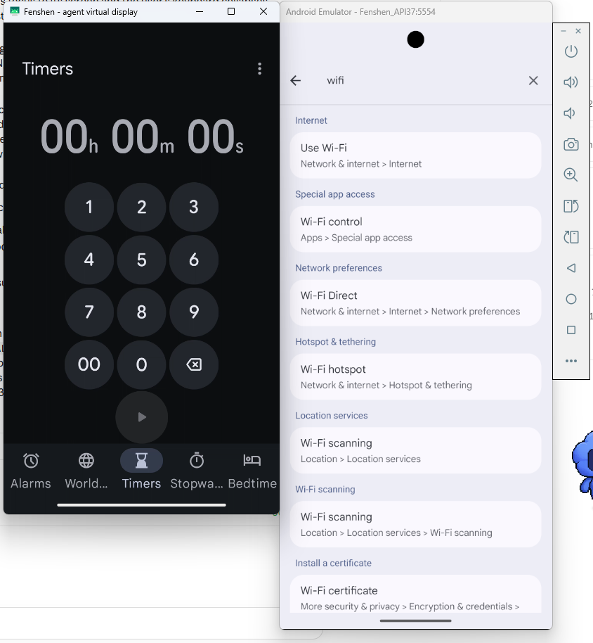
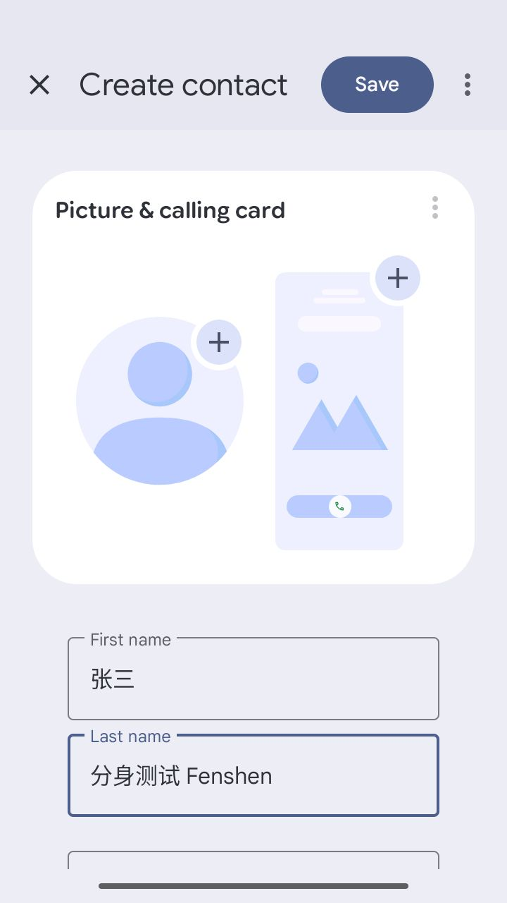
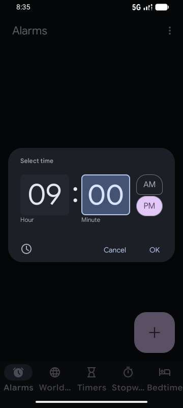
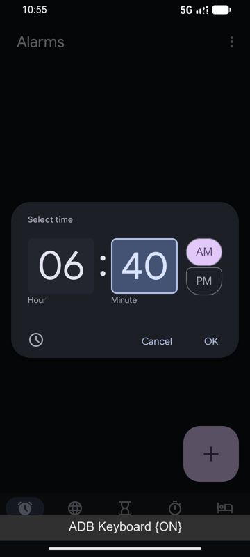

# 实测记录

每条实验记录：环境、做法（可复现的命令）、原始结果、结论。失败和推翻假设的结果同样保留。

## 环境

| 项 | 值 |
|---|---|
| 主机 | Windows 11，i5-12600KF，32 GB，RTX 3070 8 GB |
| 模拟器 | Android Emulator，WHPX 加速；系统镜像 `android-37.0 / google_apis_playstore / x86_64`（Android 17，API 37）；1080×2400 @ 420dpi |
| 工具 | adb 37.0.1；scrcpy 5.0.1 |
| 用户输入法 | Gboard（`com.google.android.inputmethod.latin`），`show_ime_with_hard_keyboard=1`（模拟器有实体键盘时也显示软键盘，这样"键盘被抢"才看得见） |

---

## E1 scrcpy 虚拟屏：启动 App 和注入触摸都会抢走用户的焦点和键盘（2026-10-27）

**目的**：验证最常见的做法（scrcpy `--new-display` + `am start --display` + `input -d`）会不会打扰正在打字的用户。对应 README §9 的第 1、3、4 项。

**做法**

```bash
# 建虚拟屏（scrcpy 在 API 34+ 会带 TRUSTED | OWN_FOCUS 等 flag）
scrcpy --new-display=720x1280/320 --display-ime-policy=hide --no-audio
# → [server] INFO: New display: 720x1280/320 (id=2)

# "用户"：主屏打开设置，点搜索框，键盘弹出，正在输入
adb shell am start -n com.android.settings/.Settings
adb shell input -d 0 tap 380 250
adb shell input -d 0 text "wifi"

# "agent"：在虚拟屏 2 上启动时钟、点击、滑动
adb shell am start -W --display 2 -n com.google.android.deskclock/com.android.deskclock.DeskClock
adb shell input -d 2 tap 360 1200
adb shell input -d 2 swipe 360 900 360 400 200

# 每一步之后采样
adb shell dumpsys window        | grep -E "mTopFocusedDisplayId|mCurrentFocus=|mFocusedApp="
adb shell dumpsys input_method  | grep -E "mInputShown|mImeWindowVis"
adb shell dumpsys activity activities | grep ResumedActivity
```

**结果**

| 时刻 | `mTopFocusedDisplayId` | 主屏 `mCurrentFocus` | 用户键盘 `mInputShown` | 主屏前台 App |
|---|---|---|---|---|
| 基线：用户在设置搜索框里打字 | **0** | 设置搜索 | **true** | 设置搜索 |
| agent `am start --display 2` 之后 | **2** | **null** | **false** | 设置搜索（未变） |
| 用户点回主屏之后 | 0 | — | — | 设置搜索 |
| agent `input -d 2 tap` 之后 | **2** | — | false | 设置搜索 |
| 用户点回主屏之后 | 0 | — | — | 设置搜索 |
| agent `input -d 2 swipe` 之后 | **2** | — | false | 设置搜索 |

另外，logcat 显示这块屏在设备层确实带上了 `FLAG_OWN_FOCUS`：

```
DisplayDeviceRepository: Display device added: DisplayDeviceInfo{"scrcpy" ... owner com.android.shell (uid 2000),
  ... FLAG_TRUSTED, FLAG_OWN_DISPLAY_GROUP, FLAG_ALWAYS_UNLOCKED, FLAG_TOUCH_FEEDBACK_DISABLED, FLAG_OWN_FOCUS ...}
```

**结论**

1. ✅ 前台 App 不会被切换：两块屏同时 RESUMED（第 ① 层没问题）。
2. ❌ **焦点和键盘会被抢**：agent 在虚拟屏上启动 App、点击、滑动，每一次都会把 top focused display 拉到虚拟屏，用户的键盘随之被收起，主屏失去焦点窗口。用户正在打的字会断掉。这就是"开个虚拟屏 + input tap"这种做法的根本缺陷。
3. ❌ **OWN_FOCUS 不够**：这块屏已经带了 OWN_FOCUS，焦点仍然被抢。OWN_FOCUS 只是让虚拟屏维护*自己的*焦点窗口，并不阻止它成为 top focused display。
4. 下一步的依据（源码 ✅）：`VirtualDisplayAdapter` 中，`VIRTUAL_DISPLAY_FLAG_STEAL_TOP_FOCUS_DISABLED` 只要求同时具备 `TRUSTED` 和 `OWN_FOCUS`；`DisplayManagerService.createVirtualDisplayInternal` 对它**没有额外的权限检查**（`TRUSTED` 需要的 `ADD_TRUSTED_DISPLAY`，shell 已有）。所以 shell 身份可以创建带 `STEAL_TOP_FOCUS_DISABLED` 的虚拟屏，而 scrcpy 没有设置这个 flag。→ E2：自研 helper 建屏并重复本实验。

**实验结束时的画面**（左：scrcpy 投出的虚拟屏 2；右：模拟器主屏）



从截图补充确认了两点：

5. ❌ **焦点被抢期间，用户的按键丢了**：顺序是先在主屏输入 `wifi`，agent 点击虚拟屏（top focus → 2）之后，再以不指定屏幕的方式输入 `XYZ`（等同于用户继续在实体键盘上打字）。主屏搜索框里只有 `wifi`，`XYZ` 没有到达用户的输入框。它被派发到了虚拟屏上的焦点窗口（计时器页面不接受字母，所以直接被丢弃）。
6. ❌ **键盘收起后没有自动回来**：用户点回主屏输入框后，`mInputShown` 仍为 `false`，截图里主屏也没有键盘。用户必须自己再次唤起键盘，原因待查。
7. ✅ 注入到虚拟屏的点击是生效的：`input -d 2 tap 360 1200` 正好点中了时钟底部的 "Timers" 标签，所以左边停在计时器页。

---

## E2 自研 helper + `STEAL_TOP_FOCUS_DISABLED`：焦点和键盘不再被抢（2026-10-27）

**目的**：验证 E1 的结论 4，也就是 shell 身份创建带 `STEAL_TOP_FOCUS_DISABLED` 的虚拟屏，能否阻止 agent 抢焦点。对应 README §9 第 6 项。

**做法**

- [`helper/`](../helper/src/com/fenshen/helper/Main.java)：约 150 行 Java，用 `app_process` 以 shell 身份运行，做法同 scrcpy-server。用一个最小的 system Context 冒充 `com.android.shell` 去构造 `DisplayManager`，以 `ImageReader` 作为 Surface 建屏，再通过 `IWindowManager.setDisplayImePolicy` 设置 IME policy。
- flags 与 scrcpy 完全一致（PUBLIC、PRESENTATION、OWN_CONTENT_ONLY、SUPPORTS_TOUCH、ROTATES_WITH_CONTENT、DESTROY_CONTENT_ON_REMOVAL、SHOULD_SHOW_SYSTEM_DECORATIONS、TRUSTED、OWN_DISPLAY_GROUP、ALWAYS_UNLOCKED、TOUCH_FEEDBACK_DISABLED、OWN_FOCUS、DEVICE_DISPLAY_GROUP），**唯一的变量是 `STEAL_TOP_FOCUS_DISABLED`**，用 `--no-steal-top-focus` 开关。
- 用同一个脚本 [`tools/focus_probe.sh`](../tools/focus_probe.sh) 测两组。步骤和 E1 相同，最后加一步"用户再点一次自己的输入框"。为了不受"只导出焦点所在屏"的影响，探针用 `uiautomator dump --windows` 按包名读取用户输入框的文字。

```bash
bash helper/build.sh push
adb shell CLASSPATH=/data/local/tmp/fenshen-helper.jar app_process / com.fenshen.helper.Main vd --ime-policy hide                       # 实验组
adb shell CLASSPATH=/data/local/tmp/fenshen-helper.jar app_process / com.fenshen.helper.Main vd --ime-policy hide --no-steal-top-focus  # 对照组
bash tools/focus_probe.sh <DISPLAY_ID>
```

logcat 确认实验组的屏在设备层同时带有 `FLAG_OWN_FOCUS` 和 `FLAG_STEAL_TOP_FOCUS_DISABLED`，没有出现 "Ignoring …" 警告。

**结果**

| 步骤 | 对照组（无该 flag，display 5） | **实验组（有该 flag，display 6）** |
|---|---|---|
| 基线：用户在主屏打字 | top=0，键盘显示 | top=0，键盘显示 |
| agent `am start --display N` | top=**5**，键盘**收起** | top=**0**，键盘**显示** |
| agent `input -d N tap` | top=5，键盘收起 | top=0，键盘显示 |
| agent `input -d N swipe` | top=5，键盘收起 | top=0，键盘显示 |
| 用户再点一次自己的输入框 | top=0，键盘**仍然收起** | top=0，键盘显示 |
| 用户输入框最终文字（先 `wifi`，焦点被抢期间再打 `XYZ`） | `"wifi"`：**XYZ 丢了** | `"wifiXYZ"`：**一个字都没丢** |

**排除"agent 其实没点上"的可能**：在实验组的屏上，agent 按界面树找到时钟底部的 "Alarms" 和 "Stopwatch" 标签并依次点击，页面标题分别变成 Alarms 和 Stopwatch；同一时刻 top focus=0，用户键盘仍然显示。同时，这块屏内部有自己的焦点窗口（`mCurrentFocus=DeskClock`），这是 OWN_FOCUS 的作用。

**附带验证**：`pkill` 结束 helper 后，虚拟屏消失，时钟 App 被销毁（`dumpsys activity` 中已无 deskclock），没有被挪到用户屏上；用户的前台 App 和键盘都不受影响。这证明 `DESTROY_CONTENT_ON_REMOVAL` 按预期工作。

**结论**

1. ✅ **`OWN_FOCUS` + `STEAL_TOP_FOCUS_DISABLED` 解决了 E1 的问题**：在 API 37 上，agent 在虚拟屏上启动、点击、滑动，都不会抢用户的焦点、收起用户的键盘，也不会吞掉用户的按键。而且这在 shell 权限下就能做到，不需要 Root。
2. ✅ 对照实验表明效果来自这一个 flag。E1 的问题出在 scrcpy 少设了这一个 flag，而不是"虚拟屏方案本身不可行"。
3. 这也意味着 agent 可以直接注入触摸和滑动，不必所有操作都依赖无障碍节点动作。节点动作仍然优先，因为它不需要坐标推理，但不再是"不打扰"的唯一保证。
4. 仍待验证：
   - API 33 及以下没有这两个 flag，需要单独对照（§9 第 4 项的低版本部分）；
   - 厂商 ROM 上的行为，需要真机；
   - agent 往虚拟屏输入文字时，键盘不出现在主屏上（§9 第 5 项）；
   - 无障碍服务能否读取并操作这块屏（§9 第 2 项）。`uiautomator dump --windows` 已能读到它的界面树，这是一个积极信号。

---

## E3 agent 读写自己的屏（含中文输入）：用户的焦点、键盘、按键都不受影响（2026-10-27）

**目的**：§9 第 2、5 项。agent 能否读取并操作 agent 屏上的控件、写入中文，同时：不在任何屏上弹出键盘，不把用户的输入法绑定抢走，不吞用户的按键。另外顺带验证同 App 冲突守卫（§6）。

**实现选择**：观察和执行没有另写无障碍 APK，而是放进 shell helper，通过 **UiAutomation** 实现（[`Automation.java`](../helper/src/com/fenshen/helper/Automation.java)）：
- UiAutomation 用的就是无障碍那套 `AccessibilityNodeInfo` / `getWindowsOnAllDisplays()` 接口，读、点、`ACTION_SET_TEXT` 都和无障碍服务相同。
- 好处：不需要编译和安装 APK，用户也不用去开无障碍权限；所有特权能力集中在一个 shell 进程里，也和 §8 的"无线调试拉起 shell 进程"落地路径一致。
- 连接时带 `FLAG_DONT_SUPPRESS_ACCESSIBILITY_SERVICES`，不会把用户自己开着的无障碍服务（如读屏）挤掉。
- 代价：UiAutomation 是独占的。helper 运行期间，`uiautomator dump`、Appium UiAutomator2 都连不上。所以 E3 读取用户输入框，要等 helper 退出之后才做。

**接口按屏隔离（不靠调用方自觉）**：
- RPC 里没有"选择屏幕"的参数。快照只遍历 agent 屏的窗口；节点动作执行前重新检查节点所在屏；注入事件统一打上 agent 屏的 displayId。
- `am start` 的 `--display` 和 `--user` 由 helper 决定，调用方传入就直接拒绝。
- RPC 只接受 shell 或 root 的 UID 连接。abstract socket 没有文件权限，不检查的话手机上任何 App 都能来连、借 shell 权限操作。

**做法**：[`tools/e3_probe.py`](../tools/e3_probe.py)

1. 用户：在主屏的设置搜索里输入 `wifi`。
2. agent：在自己的屏上打开"新建联系人"。
3. agent：用**节点点击**点 First name，`SET_TEXT "张三"`。
4. agent：用**注入点击**点 Last name，`SET_TEXT "分身测试 Fenshen"`。
5. 用户：不指定屏幕地继续打 `XYZ`。
6. agent：尝试启动用户正在用的设置 App。
7. 关闭 helper，读取用户输入框的内容。

每一步之后采样 `mTopFocusedDisplayId`、`mInputShown`、`mCurClient`（输入法当前服务的 App uid）、`mCurDisplayId`（输入法所在屏）。

**结果**（跑了两次，结果一致；原始数据在 `runs/e3-*.json`）。用户 App（设置搜索）的 uid 是 10162，agent 目标 App（联系人）的 uid 是 10170：

| 步骤 | top focus | 键盘显示 | 输入法服务的 App | 输入法所在屏 |
|---|---|---|---|---|
| 基线：用户在打字 | 0 | 是 | 10162（用户） | 0 |
| helper + UiAutomation 连接 | 0 | 是 | 10162 | 0 |
| agent 打开新建联系人 | 0 | 是 | 10162 | 0 |
| agent **节点点击** First name | 0 | 是 | 10162 | 0 |
| agent `SET_TEXT "张三"` | 0 | 是 | 10162 | 0 |
| agent **注入点击** Last name | 0 | 是 | 10162 | 0 |
| agent `SET_TEXT "分身测试 Fenshen"` | 0 | 是 | 10162 | 0 |
| 用户继续打 `XYZ` | 0 | 是 | 10162 | 0 |
| agent 尝试启动设置（用户正在用） | 0 | 是 | 10162 | 0 |
| helper 关闭后 | 0 | 是 | 10162 | 0 |

- ✅ 中文写入成功：agent 屏上两个输入框分别是 `张三`、`分身测试 Fenshen`。helper 从自己的画面缓冲截的图如下（Last name 有焦点，没有任何键盘）：

  

- ✅ agent 屏上没有出现输入法窗口；输入法自始至终绑定在用户的 App 上（uid 10162，display 0）。
- ✅ 用户输入框最终是 `wifiXYZ`，按键一个没丢。
- ✅ 冲突守卫生效：`CONFLICT: com.android.settings is open on the user's screen; not launching it on the agent display`。
- ✅ helper 关闭后，联系人 App 被销毁，草稿没有保存，用户屏不受影响。

**观察压缩**：联系人页面原始 83 个节点，压缩成 10 个元素（454 字符，大约 150 token）。第一次跑时，元素里混进了 agent 屏上的系统装饰（任务栏的 Apps list、Phone，导航栏的 Back、Home、Recents），而截图里根本看不到它们。现在只保留应用窗口的节点，系统窗口只在窗口列表里注明。

**耗时**（API 37 模拟器，中位数）：

| 操作 | 耗时 |
|---|---|
| 设备启动（push jar + 拉起 helper + RPC 连通） | 449 ms（一次性） |
| `am start -W` 冷启动联系人 | 575 ms |
| 观察（快照 + 压缩） | **4.3 ms** |
| 截图 JPEG q70 720×1280 | 9.0 ms |
| 截图 JPEG q60 缩到 360 宽 | 6.3 ms |
| `SET_TEXT` | 16 ms |

对比 `uiautomator dump`（每次 1–2 秒，还要写文件），观察和执行层基本不花时间，每一步的耗时几乎全在模型推理。

**结论**

1. ✅ §9 第 2 项：shell 身份的 UiAutomation 能读取并操作 agent 屏，节点点击、注入点击、`SET_TEXT` 都可用。
2. ✅ §9 第 5 项：IME policy HIDE + `SET_TEXT` 能写中文，任何屏都不弹键盘，输入法绑定也不被抢。
3. ✅ §6 冲突守卫：用户屏上可见的 App 不会被 agent 启动到自己的屏上。
4. 待测：
   - `ime_enter`（无键盘提交搜索）在真实 App 上的效果；
   - 低版本系统；
   - 厂商 ROM；
   - 用户点开 agent 正在后台使用的 App 时的系统行为（§9 第 8 项）。

---

## E4 用户点开 agent 正在用的 App：系统把 agent 的任务整个搬到用户屏上（2026-10-27）

**目的**：§9 第 8 项。§6 的冲突守卫只管"agent 要用的 App 用户正在用"；反过来，agent 正在虚拟屏上用某个 App，用户在自己的桌面上点开同一个 App，会发生什么？

**怎么发现的**：不是刻意设计的实验，而是 D3 调试时用户在主屏上点开了时钟（run `20261027-193644`，agent 当时正在虚拟屏 display 21 上用时钟的 Select time 对话框）。事后从 `logcat -b events` 还原：

```
19:37:34.697 wm_set_resumed_activity [0,com.google.android.deskclock/.DeskClock,addChildTask]
19:37:34.801 wm_new_intent           [0,37033265,74,com.google.android.deskclock/.DeskClock,...]
19:37:34.802 wm_task_moved           [74,74,0,1,4]      ← task 74（agent 的时钟）被移到 display 0
```

**结果**

1. 桌面图标的启动 Intent 按 taskAffinity 找到了 agent 那个已有的 Task（`wm_new_intent`，没有新建），并把它**整个移到了用户屏**（`wm_task_moved … 0`），包括 agent 做到一半的时间选择框。
2. 用户看到的是"自己点开时钟，却出现一个别人填了一半的对话框"；agent 这边，它的屏上的 App 不见了。
3. agent 下一步想重新打开时钟，被冲突守卫拒绝：`CONFLICT: com.google.android.deskclock is open on the user's screen`。它不会把 App 从用户手里抢回来。

**结论与处理**

- ❌ 这是同机方案特有的打扰，不能靠"用户别点"来回避：一个 App 同一时刻只有一个 Task 时，用户和 agent 抢的是同一个 Task。
- 当前处理（[`agent.py`](../brain/fenshen/agent.py) `ConflictError` 分支）：把它当作**交接**。如果冲突的 App 是 agent 本次任务里用过的，就告诉用户"系统把分身做到一半的界面移到了你的屏幕上，你可以自己接着完成；或者按 Home 退出，分身会自动接着做"；然后每 2 秒检查一次用户屏上还有没有这个 App（最多 10 分钟），用户一离开就自动继续，不需要再点按钮。完成校验的基线读取遇到同样情况也会等待。
- 🧪 还没做：从根上避免任务被搬走，例如 agent 用 `FLAG_ACTIVITY_MULTIPLE_TASK` 启动独立 Task，让桌面图标匹配不到它。是否可行要看系统按 affinity 找 Task 的规则，以及 App 自身的 launchMode，需要逐个 App 实测。

---

## E5 本地 qwen2.5:7b 驱动 agent 循环：0/13，但暴露了必须由结构兜住的问题（2026-10-27）

**目的**：D3 的 agent 循环端到端跑通"帮我定一个早上 X 点 Y 分的闹钟"。模型用本地 Ollama `qwen2.5:7b`（Q4_K_M，RTX 3070 8 GB，和模拟器共用显存），看压缩后的元素列表，每步输出一个受 JSON schema 约束的动作（[`ElementDecider`](../brain/fenshen/agent.py)）。

**完成判定**：不信模型说的"做完了"。[`AlarmVerifier`](../brain/fenshen/verify.py) 读系统 `dumpsys alarm` 的 *Next alarm clock*，再对比任务前后时钟里的闹钟清单（翻页读完，按行号去重），要求"恰好新增一个已开启的目标时间闹钟，没有其他变化"。

**结果**（13 次有效尝试；另有 4 次因为用户正在用时钟，被冲突守卫挡住，不计入）

| 结果 | 次数 | 例子 |
|---|---|---|
| ✅ 通过校验 | **0** | — |
| 目标时间建出来了，但多建了别的闹钟 | 2 | 6:20 建好后没认出完成，又建了 6:45 等；7:15 同理 |
| 时间错 | 4 | 早上 6:35 → 选了 PM（18:35）；6:25 → 小时没改，留着默认的 9 点（21:25）；6:30 → 建成 6:45（**抄了 skill 文本里的示例数字**）；6:10 → 6:20 |
| 循环 / 步数上限 / 连续无效动作 | 6 | 反复点已经选中的 PM；在同一页重复同一动作 3 次；25 步没完成 |
| 建对了但没说 done，而是问用户 | 1 | "您已经设置了早上 7 点 30 的闹钟，请确认是否完成任务？" |

**速度**（每步中位数）：最早 15.9 s（`num_ctx` 8192，模型一部分被挤到 CPU）→ 5 s（4096）→ **2.2–2.7 s**（按提示长度自适应 2048/4096，输出字段从 6 个减到 4 个，约 33 个输出 token）。显存和模拟器共用时，解码速度约 20 tok/s，每一个输出 token 都是时间。

**打扰监视**：13 次运行全程，top focus 和输入法都没有跑到 agent 屏上（每次 0 个样本）。有一次记录到"用户键盘被收起" 3 个样本，查时间线是用户自己从设置搜索页返回了设置首页，不是 agent 造成的；监视器已改为只在用户仍停在原页面时才计数。

**结论**（这些修正对后面换模型同样有效，所以都做在循环里，不在提示词里）

1. ✅ **完成由环境判定**：每执行一步就查一次系统闹钟（`goal_reached`），达成即停，不等模型说 done；出现了不该有的闹钟（时间不对、比基线更早）立刻停下（`unintended_change`），不让它接着"修"出更多闹钟。上面"多建闹钟"的两次就是加这条之前的结果。
2. ✅ **模型说 done 被校验否决时，结束任务交给用户**，而不是让它"继续"：对创建类任务，"继续"会让小模型再建一个。
3. ✅ **示例数字会被小模型照抄**：skill 文本里写了 "6:45" 作为例子，结果 6:30 的任务建成了 6:45。之后所有提示都不写具体数字。
4. ✅ **能确定性判断的错误不交给模型**：点纯文字、点已选中的单选项、往不可写的元素 fill，直接判无效并说明原因（不执行）。
5. ❌ **7B 模型的能力不够**：读不准单选框的选中状态、AM/PM 判断错、认不出任务已完成。结构能把错误挡住，但挡不成"成功"。→ E6 换模型。

---

## E6 换成 AutoGLM-Phone：从卡死到可用，失败按类型逐个处理（2026-10-27 ~ 28）

**目的**：E5 说明 7B 文本模型看不懂界面状态。换一个为手机 GUI 训练的视觉模型（智谱 `autoglm-phone`），**只换决策器**，设备层、守卫、校验、监视全部不变，看成功率能到多少、失败是什么类型。

**接入方式**（[`autoglm.py`](../brain/fenshen/autoglm.py)）：提示词、采样参数、输出解析沿用 Open-AutoGLM（Apache-2.0）。截图取自 helper 的画面缓冲（只有 agent 屏），坐标按 0–999 换算到 720×1600；`Tap/Swipe` 注入到 agent 屏，`Type` 对已聚焦的输入框做 `ACTION_SET_TEXT`，`Take_over` → 交接，带 `message=` 的 `Tap` → 需用户允许。Open-AutoGLM 原本操作前台主屏、靠切换系统输入法打字，这两点在这里都没有用。

### 第一次：卡死在时间选择框（run `20261027-203504`）



模型打开时钟、点了 +，然后在 Select time 框里点小时、滑动、长按、再点，14 步后被循环保护停下。界面树显示 `edit "Hour" text="09" (focused)`：小时框**已经聚焦且可写**，执行层没问题。问题在模型：Open-AutoGLM 的提示词教它"确认底部出现 `ADB Keyboard {ON}` 才说明可以输入"，而 agent 屏的 IME 策略是 HIDE（D4，为了不打扰用户），永远不会出现键盘，模型就一直以为输入框没激活。

**修正 1：输入提示对齐训练分布**。界面树报告有聚焦的输入框时，在**发给模型的那张截图**上，在键盘该出现的位置画一条 `ADB Keyboard {ON}`，并在 Screen Info 里写明哪个框已聚焦。屏幕本身不变，打字仍然是 `SET_TEXT`。同一任务随即 12 步完成（run `20261028-105400`，右图是第 12 步发给模型的图）。



### 这一次里的意外：agent 的 App 被系统回收

run `20261028-105400` 的第 2–7 步是浪费的：时钟先变黑，然后从 agent 屏上消失。`logcat -b events` 显示 10:54:11–21 低内存回收杀掉了约 30 个进程，其中有 agent 的时钟（`am_proc_died … deskclock`）。压力来自用户屏上的美团：它在 x86_64 模拟器上靠 ARM 转译运行，外卖小程序反复 native 崩溃又重启（`am_crash … Segmentation fault`）。

- agent 屏上的 App 优先级是 visible（低于用户前台 App），所以内存紧张时**先被杀的是 agent 的 App，不是用户的**。这个顺序对"不打扰"是对的。
- 处理：动作之后如果 App 从 agent 屏消失，并且 `pidof` 查不到进程，就明确告诉模型"被系统回收了，重新打开"，而不是让它对着黑屏猜。

### 基准：同一批任务反复跑，按失败类型修

每轮之前把已有闹钟全部关掉（不删除），保证"下一个闹钟"的系统校验有意义。每轮 `python tools/summarize_runs.py <起> <止>` 汇总。

| 轮次 | 本轮新增的修正 | 结果（独立校验） | 失败原因 |
|---|---|---|---|
| A（4 个任务） | 修正 1 | 2/4 | ① 把小时、分钟框当滚轮反复滑动；滑完以为焦点到了分钟框，`Type` 实际写进了仍然聚焦的小时框（出现 "Hour must be 1-12"）；② 12 小时制混乱：小时框填 15，在 03 和 15 之间来回改 |
| B（6 个） | ② 把动作效果告诉截图模型（"「Hour」现在是 \"15\""、"「PM」现在已选中"；它不读 `session.history`）；③ 滑动没效果时说明"起点处没有可滚动的东西"；④ App 经验的截图版（不写具体数字） | 校验器判 0/6；**模型实际 4/6 达成** | 校验器 bug：保存后时钟把列表滚到新闹钟处，清单扫描只往下翻，漏掉上面的行，于是判"有闹钟消失"。事后用修好的扫描读最终清单，四个目标时间各恰好多出一个，结论改为 4/6。模型的两个失败：打开时默认是 PM，没改成 AM；晚上 9 点半在 1–12 的小时框里填了 21 |
| C（8 个） | ⑤ 任务参数换算成 App 的格式（"目标是 9:30 PM：小时框填 9……确认选中的是 PM"）；⑥ 动作后同一页面新出现的短文字（校验错误）告诉模型；⑦ 扫描先回到列表顶部 | 4/8 | 2 次是我的时序问题：校验器读完基线按返回后，agent 第一张截图拍到时钟正在退出，模型去点一个已经消失的 +，然后把 agent 屏的桌面（壁纸 + 任务栏）当成锁屏，请用户解锁；1 次校验器竞态（模型做对了，时钟还在自动滚动时扫描就开始了，又漏了顶部的行）；1 次模型：8 点建成了 PM，且这次它看到的截图里有一帧是**上一次运行**的对话框（状态栏时间也是旧的），来源未能复现，怀疑是 App 重启时系统显示的任务快照窗口 |
| D（8 个） | ⑧ 校验器退出时等时钟真的离开 agent 屏；⑨ 扫描以"看到第 0 行"为准；⑩ 截图前等画面静止 200 ms；⑪ 桌面时明确告诉模型"不是锁屏" | 校验器判 6/8；**模型实际 7/8** | 前 6 个任务（包括 A–C 里失败过的全部）都通过，4–14 步。下午 4:20 模型做对了（系统下一个闹钟 16:20），扫描又漏了行：`scroll_forward` 一次翻一整页，跨在页边界的那一行从没完整出现过；改成每次慢速滑动半个列表后，连续 3 次扫描都读到 22 行、恰好多一个 4:20 PM。唯一的模型失败："明天早上八点"，打开时默认是 PM，它没改；看到列表里写着 Today，就把日期改成了明天，然后报告完成，自己的描述里写着 "8:00 PM"。系统校验拦下了 |
| E（8 个） | ⑫ 清单扫描改为半页慢速滑动、按"连续两次没有新行"结束 | **7/8**：开始执行的 7 个全部通过系统校验 + 清单对比，4–19 步，模型调用中位数 1.86 s | 第 4 个任务没有开始：这时用户正在模拟器上用时钟，系统把读基线用的时钟 Task 搬到了用户屏（E4 的情形）。用户切换 App 的一瞬间被误判成"已经离开"，随后读基线超时，异常没有被接住，程序退出。现在要求连续两次检查都空闲才继续；读基线失败就以"需要你"结束，不再崩溃。下一个任务（中午 12 点）也碰上用户在用时钟，按设计在后台等到用户离开后才开始，并且完成了 |

**每步耗时**：模型调用中位数约 1.8–2.3 s（截图约 3.2k–4.6k 输入 token，输出 30–190 token）；成功的任务 4–12 步，整体 20–50 s。

**打扰监视**：E6 的全部运行（A–D 共 26 次以上）中，top focus 和输入法跑到 agent 屏的样本数都是 0，用户键盘被收起的样本数也是 0。

**隐私**：上传到智谱的只有 agent 屏的截图（helper 自己的画面缓冲），用户屏从不截取。API Key 只从环境变量 `ZHIPU_API_KEY` 读取，不写入代码、记录或日志。

**结论**

1. ✅ **模型换了，循环不用改**：决策器接口成立；E5 加进去的结构（环境判定完成、错误结果立即停）在 E6 里一样起作用：错的闹钟（7:15 PM、8:00 PM）都被系统校验拦下，没有被报告成"办好了"。
2. ✅ **截图模型也有训练分布**：它对"能不能输入"的判断依赖训练时见过的视觉信号。我们为了不打扰用户而隐藏了键盘，就要把等价的信号还给它。
3. ✅ **能确定性给出的事实，就别让模型从图里猜**：写进了哪个框、开关现在的状态、哪里能滚动、App 是否被回收、桌面不是锁屏。每一条都对应一次真实失败。
4. ✅ **校验器和测试工具本身也会错**：基准里有两轮的大部分"失败"是我自己的扫描和时序 bug。没有"事后用另一种方式复核"，就会把它们记成模型的问题。
5. 模型错误的变化：12 小时制换算（填 15、填 21）在 D、E 轮没有出现，但**第二天（E9）又出现了一次**："晚上 10 点"填了 22，提示里写着"小时框填 10"也没用。所以不能说已经解决。之后把换算结果直接写进任务文字（"目标时间是 22:00，12 小时制写作 10:00 PM"），见 E9。这类错误每次都被系统校验拦下，没有一次被报告成"办好了"。
6. 进步主要来自哪里：从 A 到 E，修正 ①②③⑤⑥⑪ 是给模型的信息，⑦⑧⑨⑩⑫ 是修我自己的校验器和时序。后者占了一半以上，这也是"可验证"必须做扎实的原因。

---

## E7 不需要登录的第二个场景：存联系人 + 发短信，发送前停下来等用户（2026-10-28）

**为什么换场景**：美团在模拟器上登录要人脸识别，其他第三方 App 也大多要登录。模拟器上现成、不需要账号、又能**独立核实**的是联系人和短信：模拟器有一张虚拟 SIM（T-Mobile），短信能真的"发出"（不出本机）；shell 身份能读联系人库和短信库（`content query`），所以校验不依赖任何 App 的界面。

**任务**：`把王小明（13800001234）存进联系人，然后给他发短信：明天下午三点开会，别迟到`（run `20261028-120009`，从网页面板下发，模型 AutoGLM-Phone）。

**新加的部分**

- 校验器（[`verify.py`](../brain/fenshen/verify.py)）：`ContactVerifier`（联系人库里恰好新增一个同名同号码的联系人）、`SmsVerifier`（短信库里出现一条发给这个号码、内容一致的**已发送**短信；发给别人或内容不对的外发短信一出现就立即停下）、`AllOf`（两个都要成立）。任务里的"他"按同一句里的联系人名字解析。
- 守卫：发送短信等于替用户对别人说话，加入"用户允许这一步才执行"的列表（`发送|send`）。
- 通知（[`notify.py`](../brain/fenshen/notify.py)）：需要用户、完成、在后台等用户用完某个 App 时，在用户手机上发**一条普通通知**（同一个 tag，原地更新），不弹全屏、不切前台。
- 用户自己完成最后一步：通知和面板都写明"也可以自己打开「短信」"。按 E4，用户从桌面打开这个 App，系统会把 agent 写好草稿的那个 Task 搬到用户屏，用户自己点发送。面板在后台每 2 秒查一次系统状态，一旦短信库里出现这条已发送短信，就判定任务完成并发出"办好了"通知，不需要用户再点"继续"。

**结果**

| 步 | 发生了什么 |
|---|---|
| 1–2 | 打开联系人；弹出"允许联系人发送通知吗"的系统权限框，模型选了 **Don't allow** |
| 3–8 | 新建联系人，姓名、号码用 `Type`（`SET_TEXT`）写入，保存 |
| 9–11 | 在联系人详情页点"发短信"直接进入与王小明的对话，写入短信内容 |
| 12 | 要点 `Send SMS` → **守卫拦下**，任务暂停，手机上出现"分身需要你确认"的通知，面板显示"允许：点「Send SMS」" |
| 13 | 用户在面板点了允许，agent 只执行这一步 |
| 14 | 模型报告完成；校验：联系人库新增「王小明 13800001234」，短信库出现发给 13800001234 的「明天下午三点开会，别迟到」 → **通过** |

全程打扰监视 0。

**这一轮发现的问题**

1. ❌ **权限框只靠模型的选择才安全**：守卫认识中文的"授权"，不认识英文的 "Allow"。这次模型选了拒绝，如果它选了允许，就会在没问用户的情况下给 App 授权。已补上：授予权限（Allow / 允许 / Only this time）需要用户允许，拒绝（Don't allow / 不允许）不需要。
2. ❌ **通知上的点击动作做不了**：`cmd notification post -c activity …` 在 API 37 上报 `Permission Denial: getIntentSender() … not allowed to send as package android`（命令以 system 包名创建 PendingIntent，shell 不允许）。所以现在通知只能告诉用户"打开「短信」"，靠 E4 的系统行为把 agent 的 Task 带到用户屏。手机端如果有自己的 App，就可以把这个 Intent 直接挂在通知上。
3. ❌ **面板在窄窗口下点不了"开始"**：单栏布局时，左侧实时画面仍是 `position: sticky`，滚动时盖在任务表单上。已改为单栏时不固定。
4. 打扰监视的样本数只统计了"用户允许"之后的那一段（任务暂停后重新开始一次 `run()`），已改为整个任务累计。

**还没测**：用户自己打开短信、在自己屏上点发送这条路径（需要用户本人操作主屏）。后台检测逻辑已用模拟的校验器离线测过。

---

## E8 不卡顿：agent 空闲时没有代价；agent 干活时，模拟器上用户 App 的掉帧明显上升（2026-10-29）

**目的**：题目要求"不能让用户感到卡顿"。前面的实验只证明了焦点和输入法不被抢，没有任何关于流畅度的数据。

**做法**（[`tools/jank_probe.py`](../tools/jank_probe.py)）：模拟一个用户在主屏上不停上下滑动"设置"（每 20 秒约 47 次滑动），用 `dumpsys gfxinfo com.android.settings` 读这 20 秒里用户 App 的帧数、janky 帧比例和帧耗时分位数。三种条件交替进行（A B C A B C……），让模拟器宿主机负载的漂移平均落到各条件上：

- A：手机上没有我们的任何东西；
- B：helper、虚拟屏、UiAutomation 都在，但 agent 空闲；
- C：agent 在自己的屏上执行真实任务（AutoGLM，建 7:15 的闹钟），窗口开始时它已经在时钟里，窗口内执行了约 5 步。

每个窗口开始和结束时都确认"设置"仍在主屏最前面，否则作废。

**结果**（`runs/e8-20261029-160759.json`；只用前两轮）

| 条件 | 20 秒内的帧数 | janky 帧 | p90 / p99 帧耗时 |
|---|---|---|---|
| A 无 agent | 1216 / 1196 | **0.1% / 1.3%** | 18 / 19 ms |
| B agent 空闲 | 1219 / 1225 | **0.2% / 0.1%** | 18 / 19 ms |
| C agent 干活 | 994 / 1024 | **22.0% / 14.8%** | 18 / 21–29 ms |

第三轮作废：测量进行时，用户在模拟器上连按 Home（`isHomeButtonTap=true`，16:06:35 三次、16:07:00 一秒内七次，没有对应的 adb 命令），"设置"被切到后台。这是我没有事先讲清楚"测量期间会模拟滑动主屏"造成的。全程 top focus 始终在 display 0。

**结论**

1. ✅ **agent 空闲时没有代价**：B 与 A 没有差别。helper、虚拟屏和 UiAutomation 常驻不拖慢用户。
2. ❌ **agent 干活时，模拟器上用户的流畅度明显下降**：每秒约 60 帧降到约 50 帧，janky 帧从约 1% 升到 15–22%，p99 帧耗时变长。这在模拟器上**不满足**"不卡顿"。
3. 还没分清代价来自哪一块。候选：
   - 虚拟屏的合成：SurfaceFlinger 用同一个线程合成两块屏，agent 屏每一帧都要 GPU 合成到 ImageReader，再读回内存；模拟器的 GPU 是宿主机转发的，这一步可能特别贵；
   - 每步的界面树快照、截图和 JPEG 编码；
   - 时钟 App 本身在 agent 屏上的绘制。
4. 决定：卡顿先作为已知局限记录，不再继续测量（时间留给交付物）。已经做好的减负手段是 agent 屏限帧选项（helper `--fps`，即 Android 14 的 `VirtualDisplayConfig.setRequestedRefreshRate`）。抽查：在 agent 屏上滑动时钟时，不限帧每秒 13.4 帧（模拟器上本来就合成不到 60 帧，说明虚拟屏合成很贵），限 15 fps 后每秒 5.0 帧。它能把用户 App 的帧还回来多少**没有测**，所以默认不开。真机上应先测这一项。

---

## E9 更多任务类型（闹钟、联系人、短信、跨 App）：一天五轮，从 3/9 修到大部分通过（2026-10-29）

**目的**：E6 只测了建闹钟。这一轮把任务扩到联系人、短信和"存联系人再发短信"的跨 App 任务，全部从网页面板下发（[`tools/bench_tasks.py`](../tools/bench_tasks.py)），完成与否全部由系统数据库判定（闹钟服务、联系人库、短信库）。发送短信前守卫会停下等用户允许；在基准里由脚本代替用户**只允许"发送短信"这一种**操作（模拟器 SIM，测试号码），付款、登录、删除、授权一律不代点。

**结果**

| 轮次 | 任务 | 通过 | 主要失败原因 → 修正 |
|---|---|---|---|
| 0 | 9 个 | 0/9 | 每个任务 2 秒就报错：前一天的面板进程还活着，和新面板共用 8765 端口（Windows 上 `SO_REUSEADDR` 允许两个进程绑同一端口），请求落到了旧进程，它和手机的连接早断了 → 面板改成先绑端口、端口被占就直接报错退出 |
| 1 | 9 个 | **3/9** | ① 每个任务继承上一个任务留下的界面：短信任务一开始停在联系人详情页，模型在联系人里搜号码 24 步 → 面板每个新任务换一块新的 agent 屏；② 联系人的通知权限弹窗，模型选了 Allow，守卫按设计拦下交给用户 → 加"权限弹窗：任务用不到就拒绝"的经验；③ "晚上 10 点"又在 1–12 的小时框里填了 22 → 把换算结果写进任务文字本身 |
| 2 | 9 个 | **6/9** | 闹钟 2/2、联系人 3/3、跨 App 1/1 都通过；单发短信 0/3：模型把账号头像（"Sign in"）当成联系人图标去点，守卫拦下交给用户；一次智谱接口 HTTP 500 |
| 3 | 4 个短信 | 1/4 | ④ 模型把"发短信"理解成微信，微信没装，启动失败后落到 agent 屏桌面，把桌面当锁屏乱点；⑤ **发现一个严重 bug**：孙悦的电话被存成了 `13900001111")` + 换行 + 反引号，短信也发到了这个畸形号码（见下） |
| 4 | 4 个短信 | 2/4 | 模型用"消息"这个名字启动（别名表里没有），之后又在桌面上以为是锁屏 |
| 5 | 4 个短信 | **3/4** | 剩下的 1 个是我的测试设计问题：用的号码正好是联系人韩梅梅的，模型点了号码后系统打开的是"韩梅梅"的对话，模型以为找错人，退出后又搜了 30 步 |

最后一版代码下，各类任务的情况：闹钟 2/2（加上 E6 最后一轮 7/8）、新建联系人 3/3、给已有联系人发短信 3/3、跨 App（存联系人再发短信）2/2、给裸号码发短信 1/2。打扰监视全程为 0。

**⑤ 的经过：从上游继承的解析 bug，被"宽松"的校验器放过了**

- 模型在电话号码框的输出是 `do(action="Type", text="13900001111")` 后面跟着一个代码块结尾 ```` ``` ````。
- 解析沿用了 Open-AutoGLM 的写法 `s.split("text=")[1][1:-2]`，即"去掉最后两个字符"，于是把 `")`、换行和一个反引号一起写进了电话号码框。
- `ContactVerifier` 只比较号码里的数字，所以判定"联系人新增成功"。后来给孙悦发短信时，短信也发到了这个畸形号码。在真机上，这就是"发给了错误的号码"。
- 修正：
  - 解析时去掉结尾的代码块标记，文字只取到最后一个 `")`；
  - 号码比较要求两边都"长得像号码"，掺了别的字符就判不一致。这样联系人校验会失败，发错号码的短信会立刻触发"发出了一条不对的短信，先停下"；
  - 读系统库时支持值里有换行（这个换行曾让那一行短信记录解析错位，校验器才没有判出"发错了"）。
  - 每一处都补了回归测试。

**同时补上的确定性规则**

- 登录类按钮（Sign in / 登录）：第一次点不执行，告诉模型"这是登录入口，换别的路径，确实要登录就交给用户"；第二次再点才交给用户。付款、下单仍然一碰就停：那正是任务应该停下的边界。
- 启动一个没装的 App 时，告诉模型"没有安装，这台手机上有：…"，不再把底层异常原样丢给它。
- agent 屏的桌面上画一条 "HOME SCREEN - phone is unlocked / use Launch to open an app"（只改发给模型的图），和 E6 的键盘提示同一个思路：agent 屏和真手机长得不一样的地方，用模型认得的视觉信号补回来。
- "Send to (370) 000-2222" 是短信 App 的收件人候选，不是发送，从需要确认的列表里排除。
- 接口的 5xx、429、超时自动重试两次。

**结论**

1. 扩到新的任务类型后，失败原因分成三类：
   - 我的测试工具和面板本身的问题：共享端口、残留界面；
   - 模型的先验和常识："短信 = 微信"、把桌面当锁屏、24 小时制、把头像当联系人；
   - 解析和校验的漏洞：Type 解析、宽松的号码比较。
2. 第三类最危险：它会让"发错号码"被判成功。校验器的规则必须**严格**，宽松匹配要有理由；任何从外部模型输出到设备操作的解析都要有测试。
3. 对模型错误的处理思路和 E6 一致：
   - 能确定性给出的事实直接告诉它：没安装、是登录入口、是桌面；
   - 能规范化的参数写进任务：时间格式、"短信不是微信"；
   - 安全边界不靠模型自觉。

---

## E10 第一次上真机：Solana Seeker（Android 16）（2026-10-29）

**设备**：Solana Mobile Seeker，Android 16（API 36），1200×2670 @ 480dpi，arm64。只开了 USB 调试并授权电脑，没有其他设置，不需要 Root，手机上没有安装任何东西。

**只读冒烟测试**（只用隐藏屏，不改用户数据）

- helper 1.5 秒启动，隐藏屏 display 2 建成，系统接受了 `STEAL_TOP_FOCUS_DISABLED`（`FLAGS=0x1ffcb`）；
- UiAutomation 能读写隐藏屏：在上面打开计算器，读到 28 个控件，截图正常；
- 测试期间用户正在用 Chrome（还从首页切到了下载页），top focus 始终在 display 0，输入法没有被动过。

**第一个 agent 任务**："用计算器算一下 365 乘以 24 等于多少"（AutoGLM，22 步）

- 结果正确：最终屏幕上算式是 `365×24`、结果是 `8760`，模型回答 8,760。打扰监视 64 个样本，全部为 0。
- 但过程很乱：
  1. 模型用"计算器"去启动，这台手机上的标签是英文 "Calculator"，别名表里没有。虽然"没有安装，这台手机上有：…Calculator…"的提示里列出了它，模型还是先乱试了 5 步；
  2. 它先用 `Type` 往计算器的显示框写 "365 × 24"，再点 AC 把内容清掉，反复两次后才改成逐个点数字键。
- **又抓到一次校验器过宽**：屏幕证据校验把 `365`、`24` 当成了证据，这两个数是任务里给的输入，不是结果。结果对了，但如果结果是错的，它也会判通过。已改为任务里本来就有的数字和引用文字不算证据，并加了回归测试。

**结论**：同机隐藏屏方案在真机（非模拟器、Android 16）上成立，不打扰用户。第三方 App 的代表任务还要选定一个 App 才能做。

---

## E11 真机上的第三方 App：美团外卖点咖啡，停在付款前（2026-10-29）

**任务**："帮我在美团点一杯瑞幸的生椰拿铁，停在提交订单前"。美团由用户自己登录，地址和定位都是用户自己的；跑的时候用户一直在用手机。

**第 1 轮：模型一直说黑屏**。用户的屏幕是亮的，但隐藏屏截图全黑，模型拿到的是黑图。原因是建屏时沿用了 scrcpy 的 `OWN_DISPLAY_GROUP`：隐藏屏自成一个电源组，在 Seeker 上这个组是 OFF，发唤醒键也没用。模拟器上没出现过这个问题。改成默认不加这个 flag（`DEVICE_DISPLAY_GROUP`），隐藏屏跟着用户屏幕的电源走；原来的行为保留为 `--own-display-group`。代价是用户灭屏时隐藏屏也跟着灭。

**第 2 轮：7 次点击全被自己拦下**。外卖首页的搜索框每隔几秒换一次占位文字（"某某土菜馆"→"营养又健康的快餐盒饭"）。"思考期间页面变了"的检查是按控件文字比较的，于是每次点击都被判成"要点的位置上已经是别的东西"。模型开始自己编坐标修正（"点击位向右偏移了 296"），用户中止。改成：同一种控件，并且位置重叠 ≥ 60%，就算同一个控件；弹窗盖上来这种真变化照样拦（回归测试两条）。

**第 3 轮：16 步走到确认订单页，自己停下，没有付款**

- 路径：打开美团 → 外卖 → 关掉"神券到账"弹窗 → 搜索"瑞幸咖啡" → 选第一家门店 → 店内搜"生椰拿铁" → 选规格（大杯、深烘）→ 加入购物车 → 去结算 → 确认订单页，然后 `finish`。全程没有去点"立即支付"。
- 打扰监视 91 个样本，焦点和输入法被抢的次数都是 0（隐藏屏改成跟随用户屏电源以后，隔离照样成立）。
- **但校验器判了不通过，错在我**：我按模拟器上的想象写的校验器，要求页面上有"提交订单"按钮和"实付/合计"字样。真实页面上按钮叫"立即支付"，而且**整个底部支付栏没有无障碍节点**，界面树里只有订单明细（商品原价、打包费、配送费）、配送方式、预计送达时间、备注栏。
- 这暴露了两件事：
  1. **只按控件文字拦付款不够**：这一页上支付按钮在界面树里根本不存在，模型如果直接按坐标点支付栏，按文字匹配的那层规则看不到它。第二层规则看模型自己写的意图（"点击…立即支付/提交订单"），命中就交给用户，所以这层必须有。两层都漏掉时，美团会弹收银台，那里要支付密码或指纹，而 `unintended_change` 一看到收银台就停下交给用户。
  2. **确认页要按页面结构认，不能只认按钮文字**。改成：订单明细、配送信息、备注栏这三类内容至少出现两类（或者出现"提交订单/立即支付/实付"），并且页面上没有"去结算/加入购物车/选规格"（那是店铺页和购物车）。用这次的真实界面树（姓名、电话、地址已替换）做了回归测试；校验结论只引用商品名、价格和店名，不会带出同一个节点里的姓名和地址。
- 修完以后还没在真机上重跑：每跑一次都会往用户真实的美团购物车里加一杯。

---
